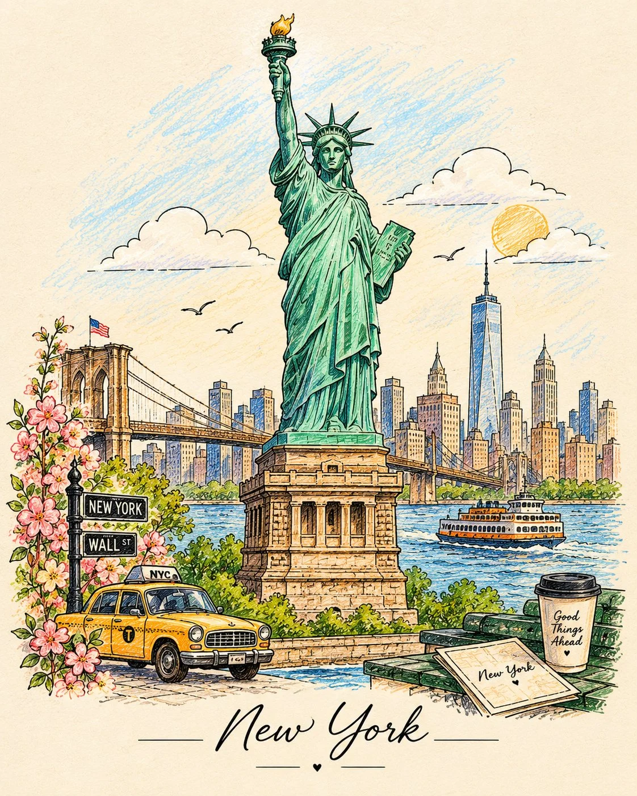

# Vintage Travel Coloring-Book Illustration Template

**中文标题：** 复古旅行涂色书插画模板  
**ID:** `gi25-x-997` · **Mode:** `generate`  
**Categories:** `general`  
**Tags:** `x-twitter`, `community`, `gpt-image-2.5`, `x-direct`, `en`



### Vintage Travel Coloring-Book Illustration Template

```text
Create a beautiful, vintage-inspired hand-drawn illustration of [COUNTRY / CITY / LANDMARK], designed as an elegant travel coloring-book artwork on a warm ivory background.

Transform the destination into a charming miniature world using delicate black ink outlines, intricate architectural details, and a sophisticated minimalist composition.

Include its most iconic landmarks, majestic mountains, traditional buildings, local transportation, cultural objects, and recognizable elements of everyday life, all blending naturally into one harmonious scene.

✨ Artistic details:

Landmarks: Feature the most recognizable architecture of the destination as the centerpiece.

Nature: Add mountains, flowing rivers, rolling hills, clouds, tiny trees, and delicate leaves inspired by the local landscape.

Cultural elements: Include traditional objects, local boats, pottery, lanterns, teapots, or other meaningful cultural details.

Line art: Use clean, delicate black outlines with varied line thickness, intricate patterns, and beautiful hand-drawn imperfections.

Color accents: Keep most of the illustration in elegant black-and-white line art, but fill selected elements with gorgeous colors—soft teal water, sage-green trees, warm terracotta rooftops, golden sunlight, and subtle pastel accents.

Composition: Arrange the elements in layered horizontal sections, creating depth without making the artwork look crowded.

Background: Use a clean, warm ivory paper texture with plenty of negative space.

Atmosphere: Peaceful, nostalgic, artistic, and full of cultural charm, like a page from a premium vintage travel sketchbook.

Typography: Write the destination's name in elegant, hand-lettered typography at the bottom, with a tiny decorative flourish.

Style: Vintage travel illustration, architectural line drawing, minimalist coloring-book aesthetic, selective watercolor fills, fine black ink, handmade sketchbook texture, sophisticated editorial design.

Aspect ratio: 4:5 vertical composition. Ultra-detailed, crisp outlines, balanced layout, beautiful and instantly recognizable destination.
```

- **Recommended model:** `gpt-image-2.5-sunburst`
- **Settings:** _(defaults)_
- **Source:** [community](https://x.com/Naiknelofar788/status/2112917886130094338) — @Naiknelofar788
- **License note:** Original public X post; quoted with attribution — remix with attribution
- **Notes:** Collected directly from X; original post https://x.com/Naiknelofar788/status/2112917886130094338; post text names GPT Image 2.5; discovered via Bin0754/gpt-image-gallery index, prompt re-verified against the original X post via api.fxtwitter.com; verified=True
- **Preview:** `previews/gi25-x-997.webp`
