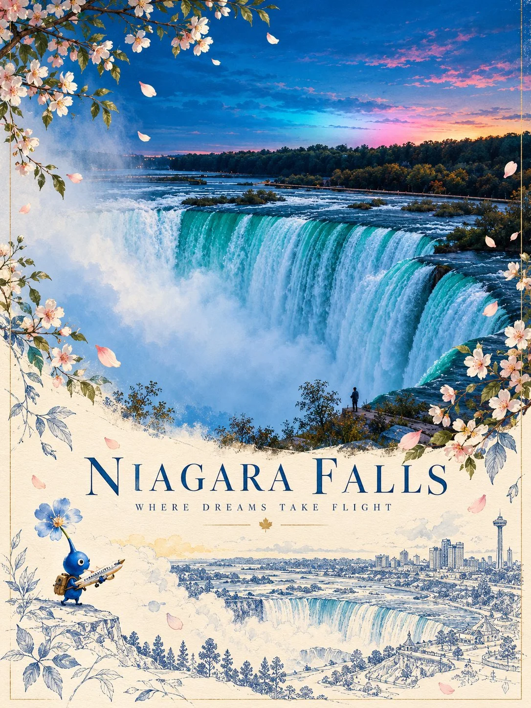

# Botanical + Blueprint Illustrated Travel Poster Template

**中文标题：** 植物插画+蓝色建筑速写旅行海报模板  
**ID:** `gi25-x-1006` · **Mode:** `generate`  
**Categories:** `poster-typography`  
**Tags:** `x-twitter`, `community`, `gpt-image-2.5`, `x-direct`, `en`



### Botanical + Blueprint Illustrated Travel Poster Template

```text
Create a sophisticated 3:4 vertical illustrated travel poster featuring [COUNTRY / CITY / DESTINATION], blending authentic architectural photography with whimsical storytelling, delicate botanical art, and elegant blue architectural sketches.

MAIN SCENE:
Feature the destination’s most recognizable landmark, preserving its authentic architecture, proportions, distinctive towers, and surrounding environment. Capture warm golden-hour sunlight, a luminous blue sky, and a natural photographic atmosphere.

BOTANICAL FRAME:
Surround the upper scene with graceful flowering branches and delicate petals, using a seasonal palette inspired by the destination. Let the flowers frame the landmark naturally without obscuring its defining features.

ILLUSTRATED SECOND WORLD:
In the lower half, transition into a warm ivory paper composition featuring a refined blue line-art illustration of the same landmark. Add floating petals, loose botanical sketches, subtle watercolor accents, and generous negative space. Include a tiny, adorable Pikmin-inspired blue flower creature carrying a miniature airplane, creating a whimsical story of courage, travel, and dreams taking flight.

COLOR & STYLE:
Sky blue, cobalt blue, soft ivory, warm gold, and delicate floral pink or blue. Combine realistic photography, fine architectural ink drawing, subtle watercolor textures, and premium editorial travel-poster design.

STORYTELLING:
Make the tiny character and its flower feel naturally connected to the destination. Convey wonder, optimism, and the poetic idea of flowers discovering their own way to fly.

TYPOGRAPHY:
Include a small, elegant destination name and restrained editorial details only where appropriate. Keep all lettering clean and correctly spelled.

Avoid distorted architecture, clutter, oversized characters, excessive decoration, harsh colors, childish cartoon styling, watermarks, and logos.

FORMAT: 3:4 vertical, high resolution, polished collectible travel-art poster.
```

- **Recommended model:** `gpt-image-2.5-sunburst`
- **Settings:** _(defaults)_
- **Source:** [community](https://x.com/Goodmanprotocol/status/2112856678551240755) — @Goodmanprotocol
- **License note:** Original public X post; quoted with attribution — remix with attribution
- **Notes:** Collected directly from X; original post https://x.com/Goodmanprotocol/status/2112856678551240755; post text names GPT Image 2.5; discovered via Bin0754/gpt-image-gallery index, prompt re-verified against the original X post via api.fxtwitter.com; verified=True
- **Preview:** `previews/gi25-x-1006.webp`
