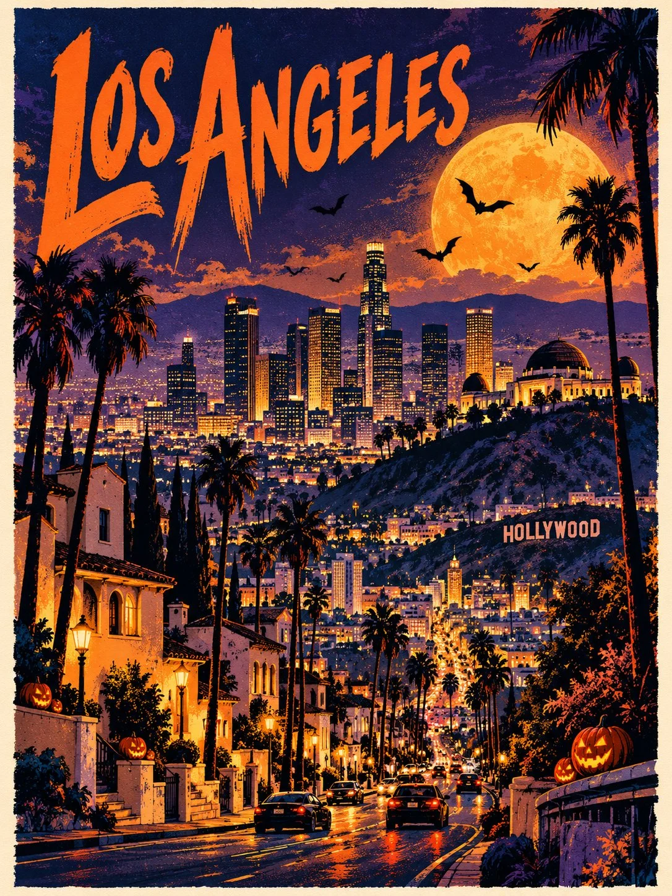

# Halloween Hand-Drawn Travel Poster Template

**中文标题：** 万圣节手绘旅行海报模板  
**ID:** `gi25-x-1029` · **Mode:** `generate`  
**Categories:** `poster-typography`  
**Tags:** `x-twitter`, `community`, `gpt-image-2.5`, `x-direct`, `en`



### Halloween Hand-Drawn Travel Poster Template

```text
UNIVERSAL HALLOWEEN TRAVEL ART POSTER

DESTINATION: [DESTINATION]

Create a bold, hand-drawn Halloween travel poster featuring [DESTINATION], blending its authentic landmarks, architecture, landscapes, and local character with a mysterious, festive Halloween atmosphere.

FORMAT

Vertical 3:4 composition, high-resolution poster artwork with clean outer margins.

CORE CONCEPT

Reimagine [DESTINATION] as a stylish Halloween-night illustration while preserving its recognizable landmarks, real architecture, geography, and regional identity. The result should feel adventurous, atmospheric, sophisticated, and collectible—not like a generic haunted town.

TYPOGRAPHY

Place "[DESTINATION]" in large, bold, custom hand-drawn lettering across the upper-left area. Keep the title highly readable and visually integrated into the composition.

Include only the destination name. No slogans, captions, extra text, logos, or watermarks.

COMPOSITION

Create a rich, vertically layered scene featuring the destination's most recognizable landmarks, streets, architecture, natural landscapes, local vegetation, and regional details. Include small pedestrians, vehicles, or everyday activities where appropriate.

Interweave these elements into one continuous illustration using expressive scale, simplified perspective, overlapping shapes, and strong foreground-to-background depth. Preserve authentic architectural details and avoid inventing or replacing real landmarks.

HALLOWEEN ATMOSPHERE

Create a dramatic Halloween evening using a glowing full moon, deep twilight skies, theatrical shadows, subtle mist, silhouetted bats, warm lantern light, and a few naturally integrated pumpkins or jack-o'-lanterns.

Adapt the details to the destination's environment and character. Keep Halloween decorations subtle so the destination remains the main subject.

COLOR PALETTE

Use a controlled palette of 4–6 colors:

- Vivid pumpkin orange
- Deep midnight navy
- Dark violet or aubergine
- Warm golden yellow
- Forest green
- Bright white highlights and negative space

Adjust the balance to suit the destination while maintaining a distinctive Halloween identity.

VISUAL STYLE

Contemporary hand-drawn travel poster with screen-print and risograph aesthetics. Use linocut-inspired shapes, rough expressive outlines, irregular handmade forms, visible ink grain, dry-brush textures, slightly misregistered color layers, and energetic scribbled shading.

Keep the architecture recognizable but artistically simplified. Emphasize tactile printing imperfections and a sophisticated independent art-book illustration style.

BACKGROUND AND MOOD

Balance generous negative space with dramatic areas of deep navy or violet night sky. Use contrasting moonlight and warm golden illumination to create depth and atmosphere. Maintain a narrow, clean margin around the poster.

The final artwork should feel like a limited-edition Halloween travel print: bold, mysterious, adventurous, festive, and visually refined.

AVOID

Photorealism, 3D rendering, smooth vector graphics, gradients, glossy surfaces, generic haunted houses, excessive skulls or pumpkins, zombies, gore, cartoon ghosts, fantasy architecture replacing real landmarks, culturally inappropriate details, muted beige backgrounds, fake vintage aging, corporate tourism branding, and additional text.

FINAL GOAL: Create an unmistakable [DESTINATION] travel poster reimagined through sophisticated Halloween illustration, authentic local details, bold colors, and expressive handmade print textures.
```

- **Recommended model:** `gpt-image-2.5-sunburst`
- **Settings:** _(defaults)_
- **Source:** [community](https://x.com/Goodmanprotocol/status/2113285350198321237) — @Goodmanprotocol
- **License note:** Original public X post; quoted with attribution — remix with attribution
- **Notes:** Collected directly from X; original post https://x.com/Goodmanprotocol/status/2113285350198321237; post text names GPT Image 2.5; discovered via Bin0754/gpt-image-gallery index, prompt re-verified against the original X post via api.fxtwitter.com; verified=True
- **Preview:** `previews/gi25-x-1029.webp`
