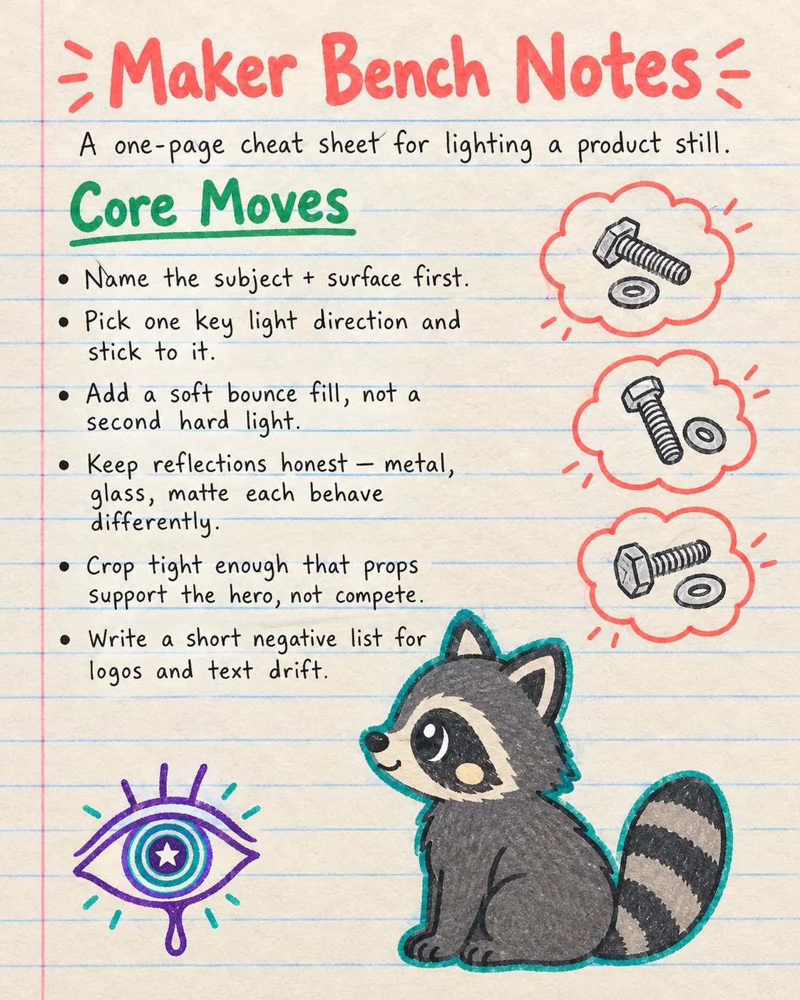

# Kawaii Notebook Anchor Chart on Product Lighting

**中文标题：** 可爱笔记本教学挂图：产品布光  
**ID:** `gi25-x-1054` · **Mode:** `generate`  
**Categories:** `poster-typography`  
**Tags:** `x-twitter`, `community`, `gpt-image-2.5`, `x-direct`, `en`



### Kawaii Notebook Anchor Chart on Product Lighting

```text
Hand-drawn classroom anchor chart on cream lined notebook paper, kawaii illustration style, clean handwritten markers, playful doodles. Vertical 4:5. Cream notebook paper with blue ruled lines and a faint pink margin. Title at top in bold coral marker: "Maker Bench Notes". Subtitle paragraph in fine black pen: "A one-page cheat sheet for lighting a product still." Green marker subtitle: "Core Moves". Bullet list in black fine pen on the left half: "Name the subject + surface first."; "Pick one key light direction and stick to it."; "Add a soft bounce fill, not a second hard light."; "Keep reflections honest — metal, glass, matte each behave differently."; "Crop tight enough that props support the hero, not compete."; "Write a short negative list for logos and text drift.". Right side: three small coral cloud bubbles, each containing a simple bolt-and-washer doodle, no text inside bubbles. Lower center: a cute matte charcoal raccoon sitting side-view with big eyes, tiny nose, soft cream cheek highlight, thick teal outline, no text on the raccoon. Lower-left corner: a surreal hand-drawn doodle eye with concentric iris rings, a tiny star pupil, three lashes, subtle drip, purple stroke with teal accent. Handwritten marker variation, slight ink bleed, visible paper texture, flat overhead classroom light. No photorealistic fur, no 3D gradients, no logos, no watermark, no UI chrome.
```

- **Recommended model:** `gpt-image-2.5-sunburst`
- **Settings:** _(defaults)_
- **Source:** [community](https://x.com/Alyssa4aicreate/status/2113070243744465308) — @Alyssa4aicreate
- **License note:** Original public X post; quoted with attribution — remix with attribution
- **Notes:** Collected directly from X; original post https://x.com/Alyssa4aicreate/status/2113070243744465308; post text names GPT Image 2.5; discovered via Bin0754/gpt-image-gallery index, prompt re-verified against the original X post via api.fxtwitter.com; verified=True; author credits the idea as inspired by @IamEmily2050 (credit line omitted from the prompt); author says it was made with GPT Image 2.5 on Token360
- **Preview:** `previews/gi25-x-1054.webp`
