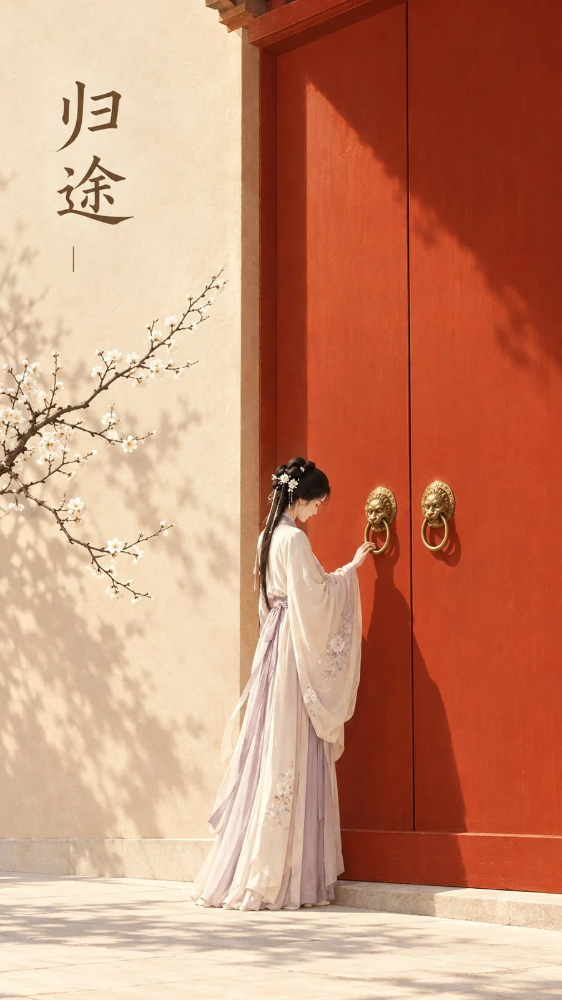

# Oriental Zen Cover: Returning Home at the Vermilion Gate

**中文标题：** 东方禅意封面：朱门“归途”  
**ID:** `gi25-x-1059` · **Mode:** `generate`  
**Categories:** `poster-typography`  
**Tags:** `x-twitter`, `community`, `gpt-image-2.5`, `x-direct`, `zh`



### Oriental Zen Cover: Returning Home at the Vermilion Gate

```text
主题方向：东方禅意极简封面海报
风格分支：女性审美高传播型
主体内容：一位古风女子站在一扇巨大高门前，侧身低头轻触门环，目光落在门环上
情绪母题：归家、安静、轻故事感
场景与意象：巨大朱砂红门体、暖米墙面、女子、浅色地面、少量光影、门旁一枝干枯白梅
构图与空间：9:16竖版构图，高门位于中上部形成主视觉，人物位于下方偏中，门体上方和一侧留出大面积标题区
色彩控制：暖米作为背景和地面基底，朱砂红用于高门主体，浅金或暖光只用于门环与门边少量高光，人物服装用浅米白或浅藕色；避免全图发红
光线与质感：明亮午后日光，门体投下清晰但简洁的阴影，平面插画海报感
画幅比例：9:16
补充要求：门必须大而简洁，透视感明确，画面干净高颜值，适合封面首图，画面留白处可配简短中文标题「归途」；无商标、无水印、无平台Logo。人物明确成年。
```

- **Recommended model:** `gpt-image-2.5-sunburst`
- **Settings:** _(defaults)_
- **Source:** [community](https://x.com/Andy4aicreate/status/2113793643891048552) — @Andy4aicreate
- **License note:** Original public X post; quoted with attribution — remix with attribution
- **Notes:** Collected directly from X; original post https://x.com/Andy4aicreate/status/2113793643891048552; post text names GPT Image 2.5; discovered via Bin0754/gpt-image-gallery index, prompt re-verified against the original X post via api.fxtwitter.com; verified=True; author credits the idea as inspired by @liyue_ai (credit line omitted from the prompt); author says it was made with GPT Image 2.5 on Token360
- **Preview:** `previews/gi25-x-1059.webp`
