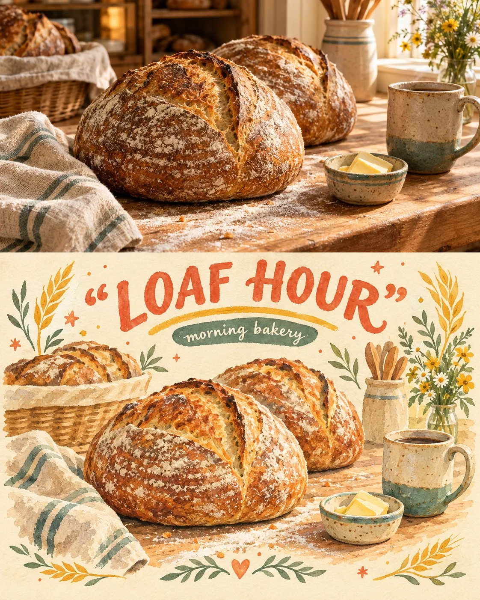

# Bakery Photo + Gouache Memory Split Poster

**中文标题：** 面包店照片+水粉回忆对半海报  
**ID:** `gi25-x-1066` · **Mode:** `generate`  
**Categories:** `poster-typography`  
**Tags:** `x-twitter`, `community`, `gpt-image-2.5`, `x-direct`, `en`



### Bakery Photo + Gouache Memory Split Poster

```text
Create a premium FULL-FRAME 4:5 vertical photo-to-illustration poster for a neighborhood morning bakery — subject: artisan sourdough loaves and a flour-dusted wooden counter. TEXT-TO-IMAGE ONLY. Precise horizontal split: upper 50% is a realistic photographic scene of warm morning bakery light over crusty boules, linen towel, small butter dish, and a hand-thrown ceramic mug; lower 50% transforms the SAME bakery counter scene into a hand-painted gouache and watercolor illustration on warm cream paper. Keep the main loaves and counter consistent across both halves. Retro postcard charm, delicate botanical flourishes of wheat stalks, playful handwritten lettering, tiny stars, subtle paper texture. Headline text in quotes: "LOAF HOUR". Small label: "morning bakery". Colors: warm ivory, sunny yellow, coral, sage green, terracotta, muted teal. Nostalgic afternoon-warm bakery atmosphere. No city skyline, no tourism landmarks, no country name as destination, no unrelated scenes, no logos, no watermarks, no 3D mockups, full-bleed artwork.
```

- **Recommended model:** `gpt-image-2.5-sunburst`
- **Settings:** _(defaults)_
- **Source:** [community](https://x.com/Alyssa4aicreate/status/2113736218961903888) — @Alyssa4aicreate
- **License note:** Original public X post; quoted with attribution — remix with attribution
- **Notes:** Collected directly from X; original post https://x.com/Alyssa4aicreate/status/2113736218961903888; post text names GPT Image 2.5; discovered via Bin0754/gpt-image-gallery index, prompt re-verified against the original X post via api.fxtwitter.com; verified=True; author credits the idea as inspired by @Goodmanprotocol (credit line omitted from the prompt); author says it was made with GPT Image 2.5 on Token360
- **Preview:** `previews/gi25-x-1066.webp`
