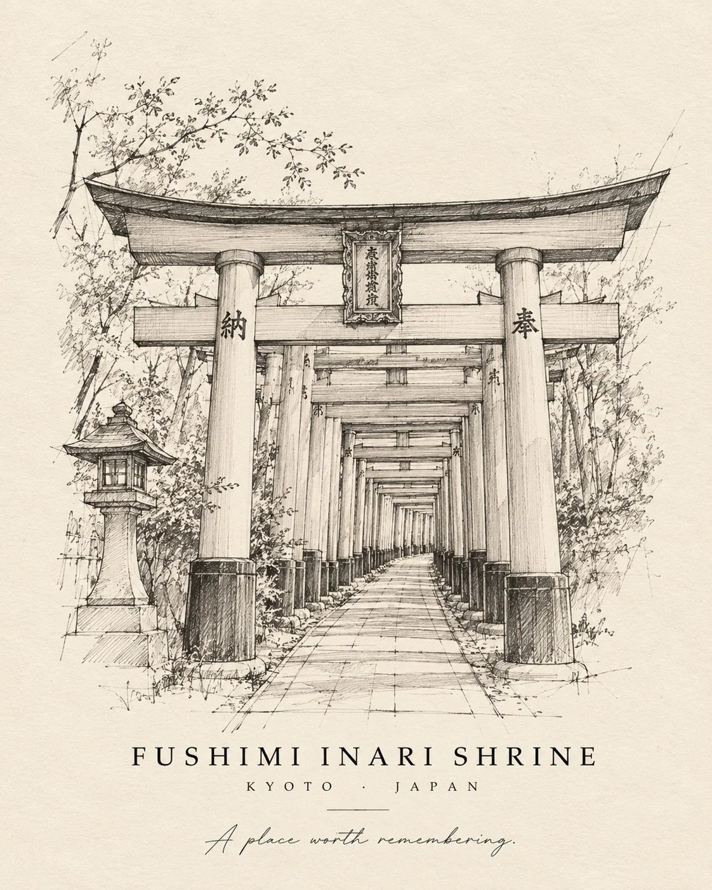

# Minimal Hand-Drawn Landmark Architectural Sketch Template

**中文标题：** 极简手绘地标建筑素描模板  
**ID:** `gi25-x-1072` · **Mode:** `generate`  
**Categories:** `poster-typography`, `general`  
**Tags:** `x-twitter`, `community`, `gpt-image-2.5`, `x-direct`, `en`



### Minimal Hand-Drawn Landmark Architectural Sketch Template

```text
Create an elegant, minimalist hand-drawn architectural sketch of [LANDMARK NAME], located in [CITY, COUNTRY].

Illustrate the landmark using delicate graphite pencil strokes, fine contour lines, subtle cross-hatching, and natural hand-drawn imperfections. Preserve its iconic silhouette and distinctive architectural details so it is instantly recognizable.

Composition: Position the landmark in the centre of warm ivory, lightly textured paper, surrounded by generous negative space. Include a few faint construction lines to give the drawing an authentic architect’s sketchbook feel.

Typography: Beneath the illustration, write the landmark’s exact name in elegant, uppercase serif lettering:

“[LANDMARK NAME]”

Below it, add the location in small, widely spaced letters:

“[CITY] · [COUNTRY]”

Finish with the tiny handwritten phrase: “A place worth remembering.”

Style: Minimalist architectural sketch, monochrome graphite, fine-line drawing, imperfect pencil edges, subtle vintage editorial design, sophisticated travel-journal aesthetic.

Colour palette: Graphite grey, soft charcoal, warm ivory.

Background: Clean, uncluttered paper texture with no scenery competing with the landmark.

Important: Keep all text correctly spelled and legible. No photorealism, no bright colours, no heavy shadows, no elaborate borders, no extra landmarks.

Format: Portrait 4:5, high-resolution art print.
```

- **Recommended model:** `gpt-image-2.5-sunburst`
- **Settings:** _(defaults)_
- **Source:** [community](https://x.com/Naiknelofar788/status/2114638446430208257) — @Naiknelofar788
- **License note:** Original public X post; quoted with attribution — remix with attribution
- **Notes:** Collected directly from X; original post https://x.com/Naiknelofar788/status/2114638446430208257; post text names GPT Image 2.5; discovered via Bin0754/gpt-image-gallery index, prompt re-verified against the original X post via api.fxtwitter.com; verified=True
- **Preview:** `previews/gi25-x-1072.webp`
