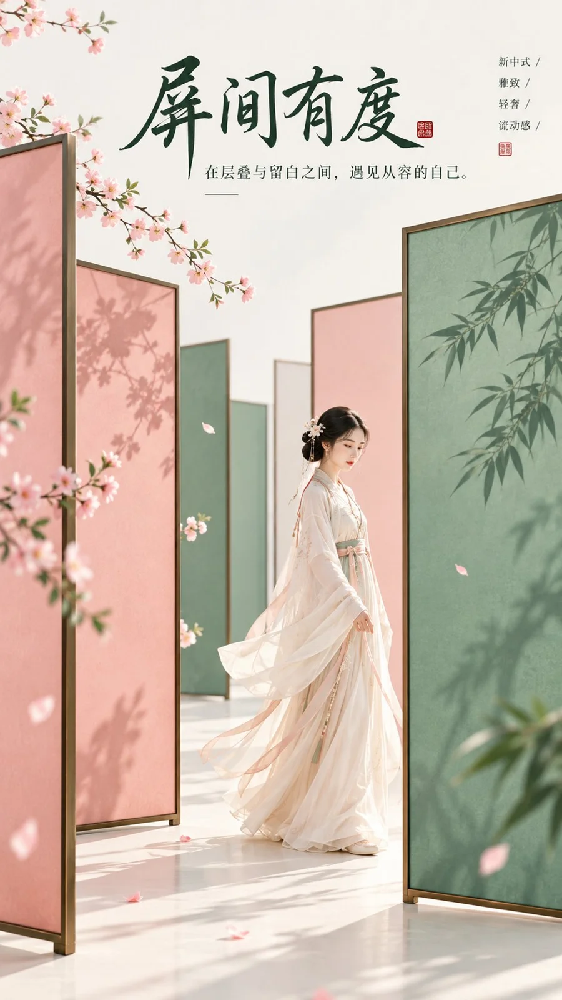

# Eastern Zen Minimal Folding-Screen Poster

**中文标题：** 屏间有度·东方禅意极简折屏海报  
**ID:** `gi25-x-1087` · **Mode:** `generate`  
**Categories:** `poster-typography`  
**Tags:** `x-twitter`, `community`, `gpt-image-2.5`, `x-direct`, `zh`



### Eastern Zen Minimal Folding-Screen Poster

```text
主题方向：东方禅意极简高传播封面
风格分支：女性审美新中式爆款型
主体内容：一位古风女子从几扇错落摆放的极简折屏之间缓步走过
情绪母题：雅致、轻奢、流动感
场景与意象：极简折屏、海棠粉色块、青玉绿色块、女子、乳白背景
构图与空间：9:16竖版构图，折屏形成层层错位的大几何色块，人物位于中下部穿行其间，顶部保留足够标题留白
色彩控制：乳白作为整体高明度基底，海棠粉和青玉绿分别用于不同折屏色块，人物服装用浅白或浅杏色；高饱和色块明确分区，避免相互污染成灰色
光线与质感：明亮柔光，边缘清晰，现代新中式平面海报感
画幅比例：9:16
补充要求：折屏要形成强主视觉和空间层次，但整体仍极简，适合做高传播封面和标题图，画面留白处配上合适的文字
```

- **Recommended model:** `gpt-image-2.5-sunburst`
- **Settings:** _(defaults)_
- **Source:** [community](https://x.com/liyue_ai/status/2114576943568105921) — @liyue_ai
- **License note:** Original public X post; quoted with attribution — remix with attribution
- **Notes:** Collected directly from X; original post https://x.com/liyue_ai/status/2114576943568105921; post text names GPT Image 2.5; discovered via Bin0754/gpt-image-gallery index, prompt re-verified against the original X post via api.fxtwitter.com; verified=True
- **Preview:** `previews/gi25-x-1087.webp`
