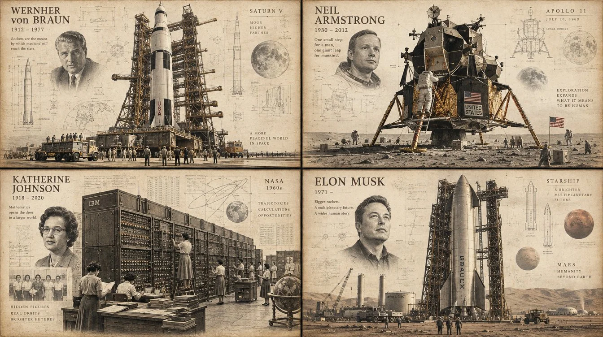

# Aerospace Legends Hybrid Historical Poster Template

**中文标题：** 航空航天传奇人物混合历史海报模板  
**ID:** `gi25-x-1098` · **Mode:** `generate`  
**Categories:** `poster-typography`, `general`  
**Tags:** `x-twitter`, `community`, `gpt-image-2.5`, `x-direct`, `en`



### Aerospace Legends Hybrid Historical Poster Template

```text
do this for 4 famous aerospace engineers: INPUT: $ SUBJECT

Create a cinematic historical-documentary poster about $ SUBJECT.

The central idea:

take ONE physical object, structure, ruin, machine,
artifact, vehicle, landscape feature, or architectural fragment
that can embody the subject,
then monumentalize it as the dominant centerpiece.

AI must first analyze $ SUBJECT and infer:

EVENT_OR_THEME
DATE_OR_PERIOD
CORE_RELIC
LOCATION
PEOPLE_INVOLVED
SECONDARY_OBJECTS
ARCHITECTURE
SYMBOLS
CONTEXTUAL_DETAILS
OPTIONAL_SHORT_QUOTE
DIAGRAM_ELEMENTS

CORE_RELIC must be the strongest physical metaphor for $ SUBJECT.

Examples:

revolution → fortress / barricade / broken gate
space exploration → helmet / lander / spacecraft
political division → wall / checkpoint
industrial disaster → damaged machine / structure
scientific discovery → apparatus / specimen
war → fortification / vehicle / ruined structure
social movement → sign / monument / public structure

────────────────────────────────

COMPOSITION

Build the image like an archival museum reconstruction.

                  TITLE
                  DATE

        tiny technical annotations

               PEOPLE
          ↗      ↑      ↖

        ┌─────────────────┐
        │                 │
        │   MONUMENTAL    │
        │    CORE RELIC   │
        │                 │
        └─────────────────┘

    crowds / machines / terrain

      faint contextual drawings

The central object should occupy approximately
55–75% of the visual mass.

Tiny human figures should interact with it:

climb
inspect
build
destroy
repair
excavate
celebrate
observe
document
transport
assemble

Scale contrast is essential.

The relic feels enormous;
people feel historically small.

────────────────────────────────

VISUAL LANGUAGE

hybrid of:

19th-century documentary engraving
+
museum reconstruction photography
+
architectural blueprint
+
archaeological survey
+
historical atlas
+
editorial history poster

The central object itself may appear highly realistic and tactile.

Surrounding information is rendered more delicately:

thin drafting lines
measurement marks
crosshairs
circles
grids
faint maps
ghost elevations
technical silhouettes
diagram arrows
tiny captions

Do NOT make this look like a modern infographic.

It should feel like a recovered archival plate.

────────────────────────────────

MATERIAL

Use historically appropriate physical texture:

stone
rust
concrete
steel
dust
wood
earth
fabric
paper
ash
paint
metal corrosion

Show age honestly:

scratches
weathering
fractures
chips
erosion
oxidation
dust
stains

────────────────────────────────

COLOR

Mostly restrained:

warm ivory
aged paper
charcoal
sepia
stone gray
rust brown
faded black

Allow ONE historically meaningful accent color when useful:

flag color
paint
graffiti
uniform
symbolic marker

Keep saturation low.

────────────────────────────────

BACKGROUND

Warm archival drafting-paper field.

Very faint:

coordinate grids
engineering circles
topographic lines
maps
elevations
date marks
annotation blocks

These elements should nearly disappear into the paper.

────────────────────────────────

TYPOGRAPHY

Top-left or upper corner:

THE / $ TITLE
or
$ TITLE

Below:

DATE / ERA

Optional micro-copy:

2–5 short lines summarizing the historical meaning.

Typography:

elegant archival serif
small caps
museum-catalog restraint
generous tracking

Never use oversized contemporary display typography.

────────────────────────────────

ADAPTIVE RULE

If $ SUBJECT has no obvious ruin or physical object,
AI must invent the most historically credible
physical metaphor rather than creating an abstract diagram.

Examples:

DEMOCRACY →
assembly hall / ballot box / public square

INTERNET →
monumental server rack / cable junction

RENAISSANCE →
workshop / printing press / architectural fragment

AI REVOLUTION →
monumental computation apparatus

────────────────────────────────

FINAL FEEL

historical
solemn
tactile
museum-quality
documentary
monumental
research-driven

One dominant physical relic,
many tiny human narratives,
almost invisible technical drafting information,
and a sense that history has been physically excavated.

No cartoon styling.
No glossy CGI.
No generic infographic boxes.
No excessive text.
```

- **Recommended model:** `gpt-image-2.5-sunburst`
- **Settings:** _(defaults)_
- **Source:** [community](https://x.com/Gdgtify/status/2114447404888121656) — @Gdgtify
- **License note:** Original public X post; quoted with attribution — remix with attribution
- **Notes:** Collected directly from X; original post https://x.com/Gdgtify/status/2114447404888121656; post text names GPT Image 2.5; discovered via X search, prompt re-verified against the original X post via api.fxtwitter.com; verified=True; author says it was tested with GPT Image 2.5 Sunburst
- **Preview:** `previews/gi25-x-1098.webp`
