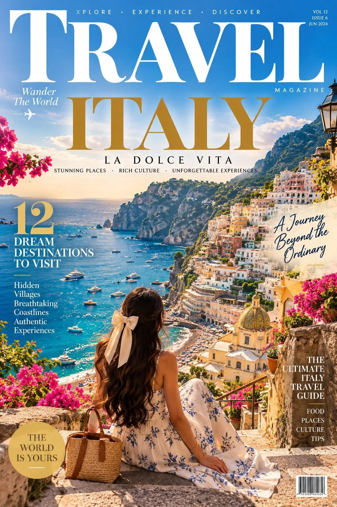

# “WANDER THE WORLD” Luxury Travel Magazine Cover

**中文标题：** “WANDER THE WORLD”奢华旅行杂志封面  
**ID:** `gi25-x-1113` · **Mode:** `generate`  
**Categories:** `poster-typography`  
**Tags:** `x-twitter`, `community`, `gpt-image-2.5`, `x-direct`, `en`



### “WANDER THE WORLD” Luxury Travel Magazine Cover

```text
🌎 Luxury Travel Magazine Cover — “WANDER THE WORLD”

Create a breathtaking, photorealistic luxury travel magazine cover titled “WANDER THE WORLD.”

Main Visual: A spectacular travel destination featuring turquoise-blue ocean water, dramatic coastal cliffs, charming white Mediterranean houses, lush green hills, and colorful flowers in the foreground. A narrow winding pathway leads toward a beautiful seaside village during golden hour. The scene feels cinematic, peaceful, adventurous, and incredibly inviting.

Magazine Design: Premium editorial layout inspired by world-class travel magazines. Place a large, elegant, bold masthead at the top reading “WANDER THE WORLD.” Add sophisticated white and warm-gold typography, perfectly aligned headlines, subtle graphic accents, and a clean, luxurious composition.

Cover Headlines:

- “THE WORLD IS YOURS”
- “12 DREAM DESTINATIONS TO VISIT”
- “Hidden Paradises Worth Discovering”
- “A Journey Beyond the Ordinary”
- “The Ultimate Luxury Travel Guide”

Visual Style: Ultra-realistic photography, rich natural colors, beautiful sunlight, atmospheric depth, crisp details, premium print quality, sophisticated typography, balanced text placement, and a high-end international travel editorial aesthetic.

Composition: Vertical A4 magazine cover, full-bleed destination photography, professional magazine hierarchy, readable text, realistic paper-cover finish, no unnecessary clutter, 8K detail.
```

- **Recommended model:** `gpt-image-2.5-sunburst`
- **Settings:** _(defaults)_
- **Source:** [community](https://x.com/Rose5303508870/status/2114712066506498302) — @Rose5303508870
- **License note:** Original public X post; quoted with attribution — remix with attribution
- **Notes:** Collected directly from X; original post https://x.com/Rose5303508870/status/2114712066506498302; post text names GPT Image 2.5; discovered via X search, prompt re-verified against the original X post via api.fxtwitter.com; verified=True
- **Preview:** `previews/gi25-x-1113.webp`
