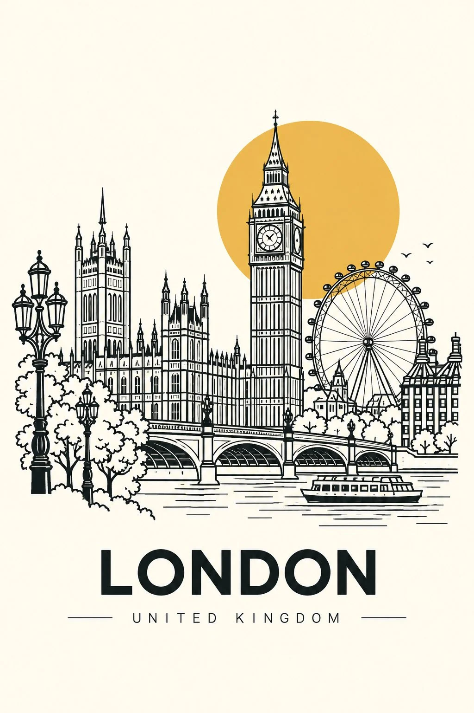

# Scandinavian Minimalist Line-Art Travel Poster Template

**中文标题：** 北欧极简线描旅行海报模板  
**ID:** `gi25-x-1134` · **Mode:** `generate`  
**Categories:** `poster-typography`, `general`  
**Tags:** `x-twitter`, `community`, `gpt-image-2.5`, `x-direct`, `en`



### Scandinavian Minimalist Line-Art Travel Poster Template

```text
Create a sophisticated minimalist travel poster featuring [CITY / COUNTRY / LANDMARK], inspired by modern Scandinavian design, architectural line art, and timeless vintage travel prints.

Illustration:
Depict the destination using clean, precise black outline drawings with simple geometric shapes, elegant architectural details, and minimal visual complexity. Include 2–3 recognizable landmarks or defining elements of the location, arranged harmoniously within a single composition. Preserve the distinctive silhouettes and recognizable features of each landmark.

Signature design elements:

A large, flat golden-yellow sun or circle positioned behind the architecture.
Thin, crisp black outlines with a consistent stroke weight.
Simplified buildings, bridges, towers, monuments, or natural features.
A warm ivory or cream background with subtle paper texture.
A restrained palette of black, cream, and muted ochre, with no unnecessary colours.
Generous negative space for a clean, premium gallery-poster aesthetic.

Typography:
Display “[CITY / DESTINATION NAME]” prominently beneath the illustration in bold, uppercase, modern sans-serif lettering. Add “[COUNTRY NAME]” in smaller, widely spaced uppercase letters when appropriate.

Composition:
A vertical 2:3 poster, centred illustration, balanced architectural arrangement, generous margins, and a clean editorial layout. The design should look like a professionally printed art poster suitable for a contemporary interior.

Mood: Minimalist, architectural, iconic, elegant, modern, and timeless.

Important: Make the destination instantly recognizable. Use landmarks that genuinely belong to the selected location. Avoid photorealism, gradients, 3D effects, excessive decoration, crowded details, and extra text. Ensure all destination names are spelled correctly.
```

- **Recommended model:** `gpt-image-2.5-sunburst`
- **Settings:** _(defaults)_
- **Source:** [community](https://x.com/Naiknelofar788/status/2115326211463553404) — @Naiknelofar788
- **License note:** Original public X post; quoted with attribution — remix with attribution
- **Notes:** Collected directly from X; original post https://x.com/Naiknelofar788/status/2115326211463553404; post text names GPT Image 2.5; discovered via X search, prompt re-verified against the original X post via api.fxtwitter.com; verified=True
- **Preview:** `previews/gi25-x-1134.webp`
