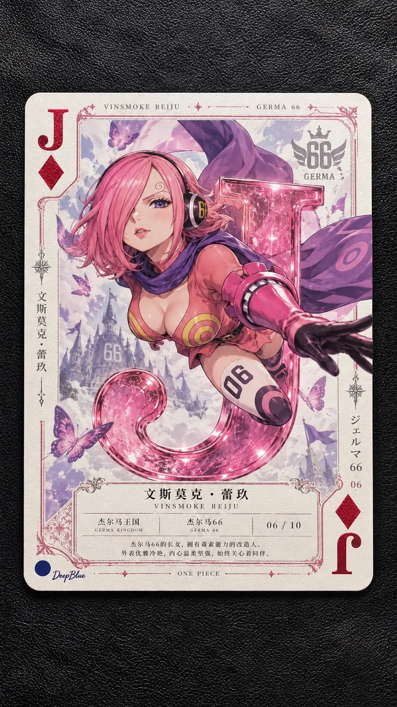

# ONE PIECE Heroines Collectible Art Poker Cards (n=10)

**中文标题：** 海贼王女性角色·收藏级艺术扑克（n=10）  
**ID:** `gi25-x-1164` · **Mode:** `generate`  
**Categories:** `poster-typography`, `general`  
**Tags:** `x-twitter`, `community`, `gpt-image-2.5`, `x-direct`, `zh`



### ONE PIECE Heroines Collectible Art Poker Cards (n=10)

```text
《ONE PIECE》经典女性角色 × 高级收藏扑克 × 人物艺术肖像 × 创意点数互动 × 精品印刷工艺。

n=10，每次独立生成一张9:16竖版图片，完整展示一张约5:7比例的实体收藏扑克牌。每张随机选择一位《海贼王》中具有代表性的成年角色，涵盖不同阵营，10张角色不重复。独立变化牌面点数、花色、人物姿态、主题色彩、数字互动与角色专属装饰，形成统一系列中的不同收藏作品。

【人物肖像】

以角色为视觉中心，准确还原尾田荣一郎原作的标志性面貌、体型、发型、服饰、武器及人物气质，保留鲜明的日式漫画造型特征。根据角色性格与经典动作变化姿态、视线、景别和构图，呈现精致且富有表现力的角色艺术肖像。

【背景设计】

背景简洁克制，采用角色代表色、柔和渐变或细腻纸面肌理，保留舒适留白。每张选择1至3种与角色直接相关的恶魔果实能力特征、武器、海贼旗徽记、服饰纹样或标志性物品，作为小面积点缀融入背景及边缘。避免复杂场景，突出角色辨识度。

【扑克牌结构与创意互动】

遵循真实扑克牌结构，左上角及右下角设置对应点数与花色的标准角标，数值一致，右下角角标旋转180度。♠♥♣♦花色符号仅用于角标与外部边框，不进入人物肖像区域。

将对应的数字或J、Q、K、A字母融入肖像构图，结合角色的能力、武器、动作与性格，随机形成触碰、倚靠、穿插、悬挂、局部遮挡、视觉错位或道具融合等创意互动。

字母与数字可以呈现金属、石雕、纸艺、透明材质或符合角色能力的特殊视觉形态，与人物产生合理的空间关系。每张采用一种主要互动方式，保持比例协调，不遮挡面容与重要身份特征。

数字牌使用2至10对应数值，人物牌使用J、Q、K，A及大小王采用专属设计。互动自然有趣，具有角色专属性与视觉记忆点。

【角色知识档案】

以精致的微型百科排版展示角色中文名、官方日文或英文名、所属阵营、身份设定、20至40字的人物简介及收藏编号。可根据角色特点选择代表性称号或能力信息，优先使用可核实的原作设定，避免虚构人物资料。

文字清晰易读，信息分区简洁，与人物肖像自然结合。

【艺术典藏工艺】

参考精品艺术扑克、博物馆纪念收藏品与限量艺术印刷。采用真实厚质艺术卡纸、细腻纸张纤维、精密印刷、自然圆角及清晰裁切边缘。

根据角色主题选择1至2种核心工艺，包括局部烫金、烫银、压凹凸纹、专色油墨、局部光油或克制的镭射细节。材质真实，细节精致，避免繁复堆砌。

【系列收藏体系】

全系列统一卡牌比例、角标位置、基础边框、字体体系、知识档案布局及收藏编号规则。根据角色特点变化主题色、肖像构图、专属点缀、数字互动和局部工艺。

单张扑克牌完整展示于简洁背景中，卡牌边缘清晰，适当留白，真实实体产品摄影质感。整体精致克制，兼具原作角色辨识度、知识价值、扑克牌趣味与限量收藏纪念品质。

左下签名：深蓝色实心圆点在前，白色手写体「DeepBlue」在后。
```

- **Recommended model:** `gpt-image-2.5-sunburst`
- **Settings:** _(defaults)_
- **Source:** [community](https://x.com/DeepBlueX0/status/2115020021743370286) — @DeepBlueX0
- **License note:** Original public X post; quoted with attribution — remix with attribution
- **Notes:** Collected directly from X; original post https://x.com/DeepBlueX0/status/2115020021743370286; post text names GPT Image 2.5; discovered via Bin0754/gpt-image-gallery index, prompt re-verified against the original X post via api.fxtwitter.com; verified=True
- **Preview:** `previews/gi25-x-1164.webp`
