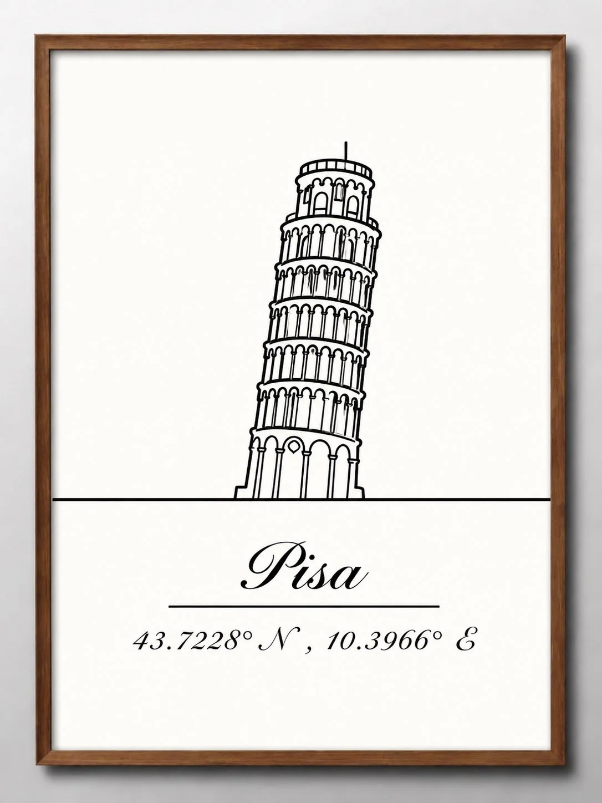

# Framed Landmark Line-Art Poster With Cursive City & Coordinates

**中文标题：** 线描地标装裱海报（花体城市名+经纬度）模板  
**ID:** `gi25-x-1176` · **Mode:** `generate`  
**Categories:** `poster-typography`, `general`  
**Tags:** `x-twitter`, `community`, `gpt-image-2.5`, `x-direct`, `en`



### Framed Landmark Line-Art Poster With Cursive City & Coordinates

```text
Create a minimalist, elegant framed wall-art poster featuring [LANDMARK NAME], [CITY], [COUNTRY], inspired by timeless architectural line-art prints.

Draw the landmark as a simple, continuous-looking black outline using clean, delicate strokes. Preserve its distinctive silhouette and essential architectural features so the landmark remains instantly recognizable. Integrate the lower part of the landmark naturally into a thin horizontal line extending across the poster, creating a balanced, geometric composition.

Design and layout:

Background: warm ivory or soft off-white.
Artwork: thin black architectural line drawing, centered with generous empty space.
Typography: write [CITY NAME] below the illustration in elegant, flowing black cursive lettering.
Add a thin horizontal divider beneath the city name.
Below the divider, display the landmark’s accurate geographical coordinates in refined, small italic serif typography.
Presentation: a simple natural walnut-brown wooden frame, photographed straight-on against a neutral white wall, with soft natural shadows.
Style: Scandinavian minimalism, understated vintage elegance, timeless gallery wall art, clean and sophisticated.
Aspect ratio: vertical 3:4 poster.

Keep the design extremely simple, balanced, and uncluttered. No extra illustrations, colorful backgrounds, decorative icons, gradients, or unnecessary text. Ensure the landmark’s outline is architecturally recognizable, the city name is spelled correctly, and the coordinates correspond to the actual location.

Replace all bracketed fields with the correct information for the chosen destination.
```

- **Recommended model:** `gpt-image-2.5-sunburst`
- **Settings:** _(defaults)_
- **Source:** [community](https://x.com/Naiknelofar788/status/2115457601823801397) — @Naiknelofar788
- **License note:** Original public X post; quoted with attribution — remix with attribution
- **Notes:** Collected directly from X; original post https://x.com/Naiknelofar788/status/2115457601823801397; post text names GPT Image 2.5; discovered via Bin0754/gpt-image-gallery index, prompt re-verified against the original X post via api.fxtwitter.com; verified=True
- **Preview:** `previews/gi25-x-1176.webp`
