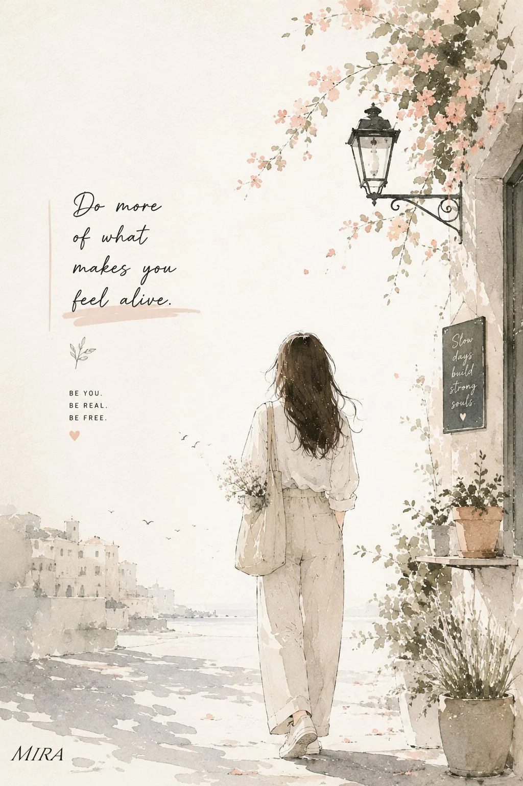

# Watercolor-and-Ink Sketchbook Travel Poster With Handwritten Quote

**中文标题：** 水彩墨线手账风旅行海报（手写短句）  
**ID:** `gi25-x-1178` · **Mode:** `generate`  
**Categories:** `poster-typography`, `general`  
**Tags:** `x-twitter`, `community`, `gpt-image-2.5`, `x-direct`, `en`



### Watercolor-and-Ink Sketchbook Travel Poster With Handwritten Quote

```text
Create a minimal, elegant watercolor-and-ink illustration poster with a soft handmade artist-sketchbook aesthetic. Show a young woman standing or slowly walking away from the viewer, full body visible, with long naturally flowing dark hair, wearing modest, relaxed neutral clothing such as a loose cream shirt, beige wide-leg trousers and simple sneakers, carrying a small canvas tote with delicate flowers. Place her in a peaceful European/Mediterranean-inspired street or countryside setting, with subtle old architecture, a vintage street lamp, climbing flowers, small plants and a few distant birds. Use very light pastel colors — warm ivory, cream, dusty peach, pale sage, soft beige and diluted gray — with lots of clean negative space. Blend delicate black ink outlines with loose transparent watercolor washes, visible watercolor-paper texture, imperfect brush edges and tiny paint splashes. Keep the composition airy, sophisticated and artistic rather than busy, like an original travel-journal illustration by a contemporary artist. Add one short, tasteful handwritten inspirational phrase in an empty area of the poster, with very small minimalist typography underneath. Soft natural daylight, peaceful atmosphere, subtle shadows, premium editorial composition, handcrafted feel, no photorealism, no heavy colors, no bold graphics, no clutter. Vertical 2:3 poster composition.
```

- **Recommended model:** `gpt-image-2.5-sunburst`
- **Settings:** _(defaults)_
- **Source:** [community](https://x.com/miratechtool/status/2115427118490206293) — @miratechtool
- **License note:** Original public X post; quoted with attribution — remix with attribution
- **Notes:** Collected directly from X; original post https://x.com/miratechtool/status/2115427118490206293; post text names GPT Image 2.5; discovered via Bin0754/gpt-image-gallery index, prompt re-verified against the original X post via api.fxtwitter.com; verified=True
- **Preview:** `previews/gi25-x-1178.webp`
