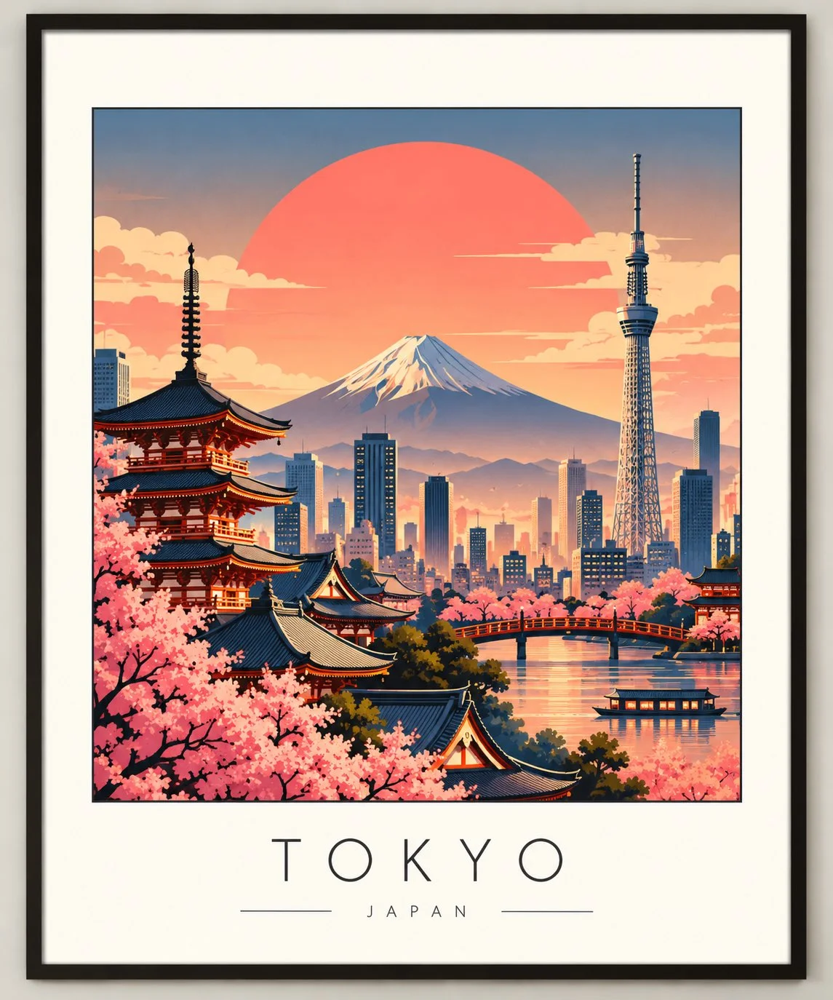

# Retro-Modern Japanese-Style Travel Poster Template

**中文标题：** 复古现代日式旅行海报模板  
**ID:** `gi25-x-1184` · **Mode:** `generate`  
**Categories:** `poster-typography`, `general`  
**Tags:** `x-twitter`, `community`, `gpt-image-2.5`, `x-direct`, `en`



### Retro-Modern Japanese-Style Travel Poster Template

```text
Create a premium retro-modern travel art poster featuring [CITY / COUNTRY / LANDMARK], inspired by vintage Japanese travel posters, mid-century modern illustration, and minimalist architectural art.

Main illustration:
Build a beautiful layered composition featuring the destination’s most iconic landmarks, recognizable architecture, skyline, and cultural elements. Arrange them at different depths to create a cinematic miniature cityscape. Include 2–4 distinctive landmarks that genuinely belong to the chosen location.

Signature visual style:

A large, oversized circular sun or moon positioned behind the skyline.
Dreamy sunset gradients blending dusty coral, muted terracotta, peach, pale gold, and smoky teal or slate blue.
Clean geometric shapes, simplified silhouettes, and elegant architectural outlines.
Atmospheric mountain ranges, stylized clouds, distant skyscrapers, bridges, temples, towers, or traditional rooftops where appropriate.
Subtle layering, soft shadows, and a balanced composition inspired by vintage screen-printed travel artwork.
A refined, slightly nostalgic colour palette with a smooth matte finish and minimal visual clutter.

Poster layout:
Place the illustration inside a neat rectangular artwork panel with a thin dark border. Surround it with a generous warm-white or ivory margin, creating the appearance of a sophisticated framed gallery print.

Below the illustration, display the exact destination name — “[DESTINATION NAME]” — in thin, widely spaced uppercase lettering. Keep the typography elegant, understated, and centred.

Mood: Dreamy, cinematic, nostalgic, sophisticated, peaceful, and effortlessly stylish.

Format: Vertical 4:5 composition, premium wall-art aesthetic, crisp details, harmonious geometry, beautiful negative space, and a polished editorial finish.

Important: Preserve the recognizable silhouettes and architectural characteristics of the actual landmarks. Make the destination instantly identifiable. Avoid photorealism, 3D renders, excessive details, cartoon characters, and unnecessary text. Ensure the destination name is spelled correctly.
```

- **Recommended model:** `gpt-image-2.5-sunburst`
- **Settings:** _(defaults)_
- **Source:** [community](https://x.com/Naiknelofar788/status/2115692463645958589) — @Naiknelofar788
- **License note:** Original public X post; quoted with attribution — remix with attribution
- **Notes:** Collected directly from X; original post https://x.com/Naiknelofar788/status/2115692463645958589; post text names GPT Image 2.5; discovered via X search, prompt re-verified against the original X post via api.fxtwitter.com; verified=True
- **Preview:** `previews/gi25-x-1184.webp`
