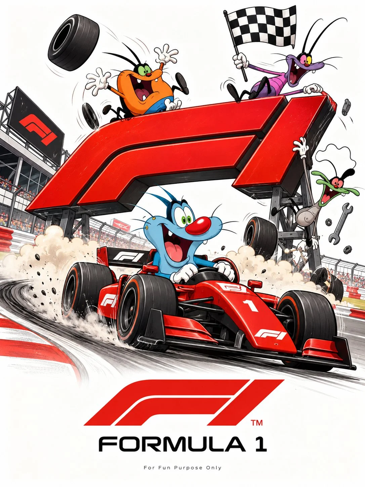

# Cartoon Character × Brand Logo Parody Poster

**中文标题：** 卡通角色×品牌 Logo 恶搞海报  
**ID:** `gi25-x-1185` · **Mode:** `generate`  
**Categories:** `poster-typography`, `general`  
**Tags:** `x-twitter`, `community`, `gpt-image-2.5`, `x-direct`, `en`



### Cartoon Character × Brand Logo Parody Poster

```text
UNIVERSAL PROMPT - CARTOON CHARACTER × BRAND LOGO PARODY POSTER

Create a humorous, high-quality cartoon illustration poster featuring [BRAND NAME / LOGO] reimagined as a playful visual parody. Transform the brand’s recognizable logo, symbol, product, or typography into a creative physical environment where [CARTOON CHARACTER(S)] interact with it in a funny, exaggerated, story-driven way.

CONCEPT & STORYTELLING: Build an imaginative scene around the brand’s identity, using clever visual metaphors, slapstick comedy, exaggerated actions, dynamic poses, and expressive cartoon reactions. The brand logo must become an integral part of the scene rather than simply appearing as a label. For example, characters can ride, climb, chase, stretch, repair, bounce off, or play around with a giant three-dimensional interpretation of the logo or product.

ART STYLE: Premium hand-drawn comic illustration, expressive cartoon anatomy, bold clean outlines, energetic motion lines, exaggerated facial expressions, playful sound effects, vibrant colors, polished cel shading, and detailed ink work. Use the visual language of classic animated slapstick cartoons combined with contemporary commercial illustration.

COMPOSITION: One standalone poster in a vertical 3:4 aspect ratio. Place the main visual concept prominently in the center, with the brand name or recognizable logo clearly visible near the bottom. Maintain a clean white or subtly off-white background, balanced negative space, and a professional poster layout. Include small supporting details only when they strengthen the joke or story.

BRAND INTEGRATION: Preserve the brand’s recognizable name, signature colors, and essential logo structure wherever appropriate, creatively adapting the design into the illustrated scene. Make the visual pun immediately understandable and memorable.

FINISHING DETAILS: Crisp high-resolution illustration, clean edges, professional commercial artwork, consistent character proportions, readable typography, rich but controlled colors, and a cohesive composition. Add the small footer text “For Fun Purpose Only” at the bottom.

CUSTOMIZATION VARIABLES:

- Brand: [BRAND NAME]
- Logo or product: [LOGO / PRODUCT]
- Characters: [CHARACTER NAMES]
- Visual joke: [FUNNY CONCEPT]
- Brand colors: [COLORS]

IMPORTANT: Every poster must feature a new, original visual gag tailored to the selected brand. Avoid generic logo placement, random characters, cluttered backgrounds, and unrelated decorative elements. Prioritize clever storytelling, immediate visual recognition, and humorous interaction between the characters and the brand.
```

- **Recommended model:** `gpt-image-2.5-sunburst`
- **Settings:** _(defaults)_
- **Source:** [community](https://x.com/Goodmanprotocol/status/2115689766155120839) — @Goodmanprotocol
- **License note:** Original public X post; quoted with attribution — remix with attribution
- **Notes:** Collected directly from X; original post https://x.com/Goodmanprotocol/status/2115689766155120839; post text names GPT Image 2.5; discovered via X search, prompt re-verified against the original X post via api.fxtwitter.com; verified=True
- **Preview:** `previews/gi25-x-1185.webp`
