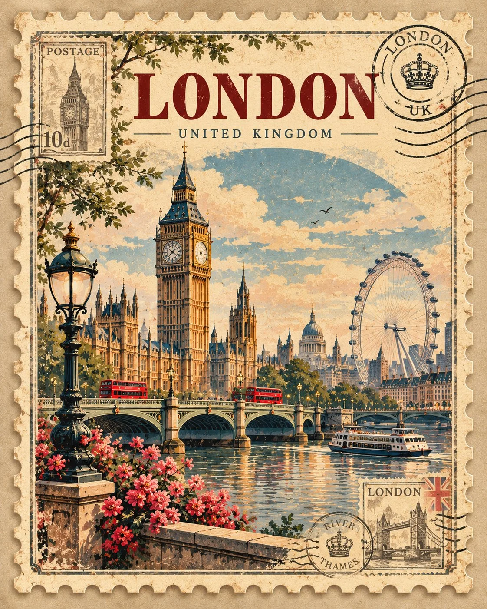

# Vintage Postage-Stamp Destination Art Poster Template

**中文标题：** 复古邮票风目的地艺术海报模板  
**ID:** `gi25-x-1191` · **Mode:** `generate`  
**Categories:** `poster-typography`, `general`  
**Tags:** `x-twitter`, `community`, `gpt-image-2.5`, `x-direct`, `en`



### Vintage Postage-Stamp Destination Art Poster Template

```text
Create a collectible vintage postage-stamp art poster for [DESTINATION]. Feature its most recognizable landmark inside an ornate stamp border with perforated edges, subtle postal cancellation marks, faded ink, antique cream paper, destination name and elegant muted colours. Highly detailed, authentic printmaking aesthetic, vertical 4:5.
```

- **Recommended model:** `gpt-image-2.5-sunburst`
- **Settings:** _(defaults)_
- **Source:** [community](https://x.com/Naiknelofar788/status/2115820077312524439) — @Naiknelofar788
- **License note:** Original public X post; quoted with attribution — remix with attribution
- **Notes:** Collected directly from X; original post https://x.com/Naiknelofar788/status/2115820077312524439; post text names GPT Image 2.5; discovered via Bin0754/gpt-image-gallery index, prompt re-verified against the original X post via api.fxtwitter.com; verified=True
- **Preview:** `previews/gi25-x-1191.webp`
