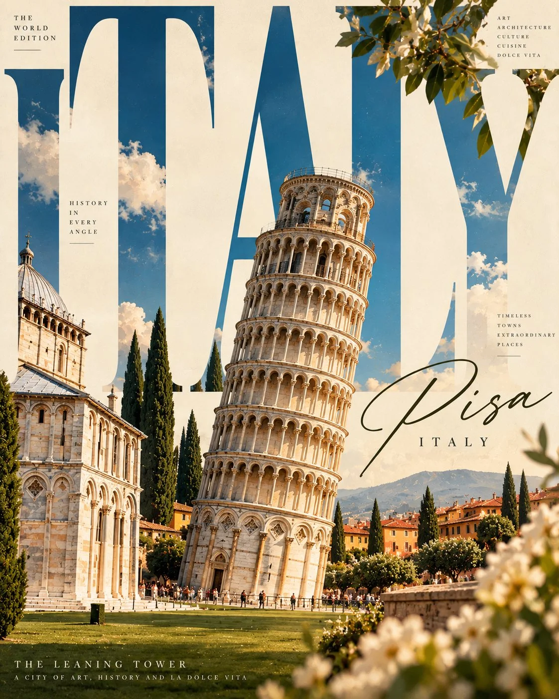

# Giant-Typography Architecture Travel Magazine Cover Template

**中文标题：** 巨型字体×地标建筑旅行杂志封面模板  
**ID:** `gi25-x-1192` · **Mode:** `generate`  
**Categories:** `poster-typography`, `general`  
**Tags:** `x-twitter`, `community`, `gpt-image-2.5`, `x-direct`, `en`



### Giant-Typography Architecture Travel Magazine Cover Template

```text
Create an extraordinary, avant-garde editorial travel-art poster featuring [CITY / COUNTRY / LANDMARK], where oversized typography becomes the central architectural element of the composition.

THE BIG IDEA:

Make the destination name enormous. Let the letters dominate the entire artwork, interacting with the actual architecture in unexpected and visually striking ways.

The iconic landmark should appear integrated into, behind, between or partially emerging from the giant letters.

Typography and composition:

Use massive, bold, custom-designed uppercase typography spelling “[DESTINATION NAME]”.
Allow architectural structures to overlap, intersect or emerge through individual letters.
Experiment with cropped lettering, unusual alignments, vertical text and asymmetrical layouts.
Create a striking relationship between typography and architectural photography.
Preserve excellent readability despite the experimental composition.

Visual direction:

Luxury international editorial design.
Dramatic architectural photography with natural shadows.
Sophisticated geometric composition.
Beautiful contrast between oversized lettering and fine architectural details.
Premium print textures and subtle grain.
Unexpected cropping and generous negative space.

Colour palette: Choose a destination-inspired combination of no more than three dominant colours, with refined neutral tones.

Editorial details:
Masthead: THE TYPOGRAPHY ISSUE
Main title: [DESTINATION NAME]
Subtitle: ARCHITECTURE IN EVERY LETTER
Small edition number and discreet editorial annotations.

Presentation: Vertical 4:5 art-directed magazine cover, contemporary graphic design, museum-quality print aesthetic, bold visual identity.

Important: The letters must be an integral part of the artwork, not simply text placed underneath a photograph. Keep the landmark geographically and architecturally accurate. Ensure the destination name is spelled correctly.
```

- **Recommended model:** `gpt-image-2.5-sunburst`
- **Settings:** _(defaults)_
- **Source:** [community](https://x.com/Naiknelofar788/status/2116006343018762522) — @Naiknelofar788
- **License note:** Original public X post; quoted with attribution — remix with attribution
- **Notes:** Collected directly from X; original post https://x.com/Naiknelofar788/status/2116006343018762522; post text names GPT Image 2.5; discovered via X search, prompt re-verified against the original X post via api.fxtwitter.com; verified=True
- **Preview:** `previews/gi25-x-1192.webp`
