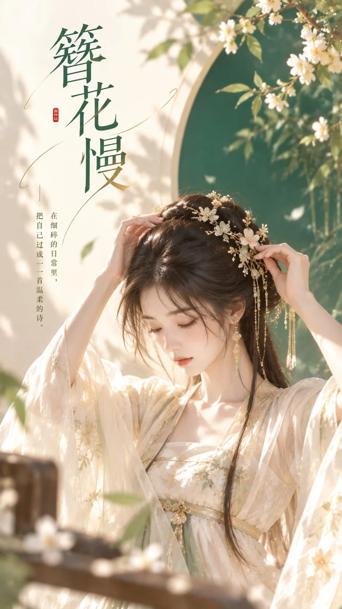

# Emerald-and-Cream New Chinese Hairpin Cover Poster

**中文标题：** 簪花慢·翡翠绿新中式封面海报  
**ID:** `gi25-x-1195` · **Mode:** `generate`  
**Categories:** `poster-typography`, `general`  
**Tags:** `x-twitter`, `community`, `gpt-image-2.5`, `x-direct`, `zh`



### Emerald-and-Cream New Chinese Hairpin Cover Poster

```text
主题方向：东方禅意极简爆款封面
风格分支：女性审美新中式型
主体内容：一位古风女子低头整理发簪，半身近景，动作细致安静
情绪母题：雅致、细腻、精致感
场景与意象：翡翠绿背景色块、奶油白空间、女子、少量金色发簪高光
构图与空间：9:16竖版构图，人物位于中下部偏中，背景用大块干净色面承托人物，上方保留标题区
色彩控制：奶油白作为高明度背景与服装基底，翡翠绿用于背景主色块，浅金只用于发簪细节和极少量高光；避免全图发绿
光线与质感：柔和自然光，人物边缘清晰，发簪与发丝细节精致，平面海报感干净利落
画幅比例：9:16
补充要求：重点突出人物气质和发饰细节，人物必须美观精致，背景简洁有高级感，画面留白处配上合适的文字
```

- **Recommended model:** `gpt-image-2.5-sunburst`
- **Settings:** _(defaults)_
- **Source:** [community](https://x.com/liyue_ai/status/2116058737857155168) — @liyue_ai
- **License note:** Original public X post; quoted with attribution — remix with attribution
- **Notes:** Collected directly from X; original post https://x.com/liyue_ai/status/2116058737857155168; post text names GPT Image 2.5; discovered via X search, prompt re-verified against the original X post via api.fxtwitter.com; verified=True
- **Preview:** `previews/gi25-x-1195.webp`
