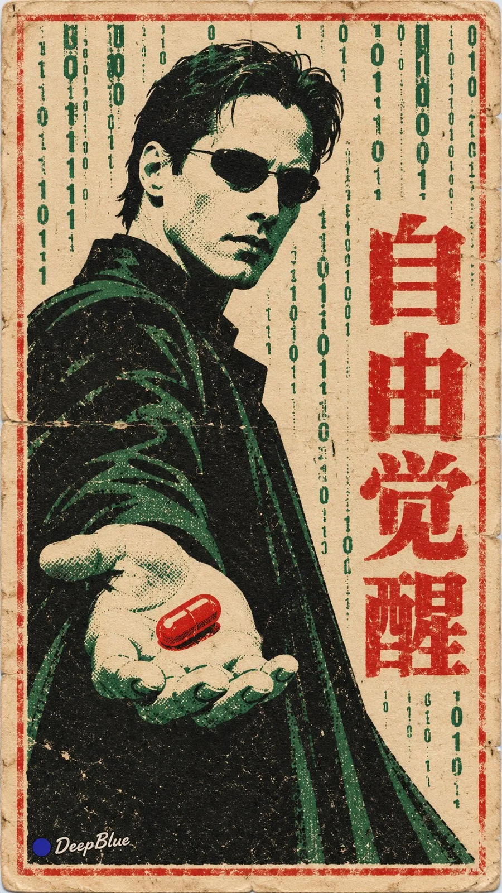

# Classic Movies as Vintage Chinese Matchbox Labels (Gacha, n=10)

**中文标题：** 经典电影×老火花火柴盒贴画抽卡（n=10）  
**ID:** `gi25-x-1200` · **Mode:** `generate`  
**Categories:** `poster-typography`, `general`  
**Tags:** `x-twitter`, `community`, `gpt-image-2.5`, `x-direct`, `zh`



### Classic Movies as Vintage Chinese Matchbox Labels (Gacha, n=10)

```text
老火花 × 经典电影开放抽卡 × 中国1960至1980年代火柴盒贴画风格 × 套色印刷与平铺扫描

每张随机选择一部不同的经典电影，提取具有辨识度的人物、情境或标志性元素，转译为一枚完整的老火柴盒贴画，形成电影经典与怀旧印刷的趣味结合。

造型概括鲜明，以纸色为底，主体采用2至3色平涂，保留适量印刷网点与轻微套印错位。纸张保存状态随机，年代痕迹轻微，印刷图形保持清楚。

随机探索电影情境、主体状态、配色、图形组织、文字位置与版式，保留原片的核心识别。画面配一句呼应电影主题的中文短口号，采用宋体，简短可读。口号语气随电影变化，文字与图像共同参与构图，形成有趣呼应。

贴画平整正视，呈现纸本印刷与扫描质感。

同批保持统一的年代感与印刷语言，电影、画面结构与口号差异明显。

n=10，9:16竖版，每次生成一张独立图片，逐张输出，不拼图。

左下签名：深蓝色实心圆点在前，白色手写体「DeepBlue」在后。白色字迹带极细灰色描边。
```

- **Recommended model:** `gpt-image-2.5-sunburst`
- **Settings:** _(defaults)_
- **Source:** [community](https://x.com/DeepBlueX0/status/2116003113312383191) — @DeepBlueX0
- **License note:** Original public X post; quoted with attribution — remix with attribution
- **Notes:** Collected directly from X; prompt posted as the author's own reply https://x.com/DeepBlueX0/status/2116003113312383191 to https://x.com/DeepBlueX0/status/2116003089950097658, which carries the images; GPT Image 2.5 is named in the reply; discovered via X search, prompt re-verified against the original X post via api.fxtwitter.com; verified=True
- **Preview:** `previews/gi25-x-1200.webp`
