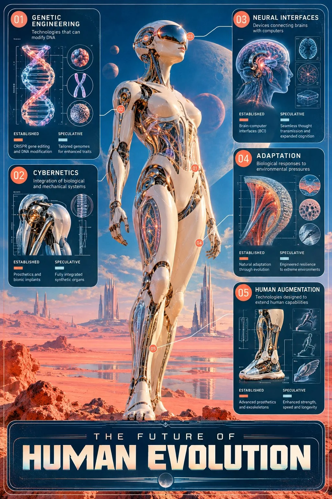

# Retro-Futurist 'Future of Human Evolution' Science Infographic

**中文标题：** 复古未来主义“人类进化的未来”科学信息图  
**ID:** `gi25-x-1205` · **Mode:** `generate`  
**Categories:** `poster-typography`, `general`  
**Tags:** `x-twitter`, `community`, `gpt-image-2.5`, `x-direct`, `en`



### Retro-Futurist 'Future of Human Evolution' Science Infographic

```text
[Create an extraordinary speculative science infographic titled exactly "THE FUTURE OF HUMAN EVOLUTION", featuring an enormous futuristic human figure standing in the center of an endless coral-pink desert beneath a magnificent electric-blue sky. The figure possesses a smooth porcelain-white synthetic body, elegant chrome joints, translucent anatomical structures and a mysterious reflective visor concealing its eyes. Selected sections of the body reveal sophisticated biomechanical adaptations, advanced sensory systems and imagined evolutionary modifications. Surround the monumental figure with five educational sections: "01 — GENETIC ENGINEERING: Technologies that can modify DNA", "02 — CYBERNETICS: Integration of biological and mechanical systems", "03 — NEURAL INTERFACES: Devices connecting brains with computers", "04 — ADAPTATION: Biological responses to environmental pressures", "05 — HUMAN AUGMENTATION: Technologies designed to extend human capabilities". Include five miniature scientific diagrams representing a DNA helix, artificial joint, neural interface, adaptive biological structure and futuristic prosthetic limb. Connect each educational section to the corresponding anatomical region using elegant thin annotation lines and small numbered markers. Clearly distinguish established technologies from speculative future developments. Make the central figure appear monumental, mysterious and extraordinarily beautiful, combining scientific curiosity with the atmosphere of a forgotten utopian science-fiction film. Place the exact uppercase English headline "THE FUTURE OF HUMAN EVOLUTION" prominently in the dedicated bottom title area.]

Extraordinary retro-futuristic science-fiction photography aesthetic inspired by late-1970s experimental cinema, 1980s visionary technology advertising and nostalgic analog film imagery, sophisticated surreal photorealism, dreamlike futuristic environments, monumental minimalist compositions, elegant humanoid silhouettes, smooth porcelain-white synthetic surfaces, highly polished chrome components, reflective metallic visors, translucent glass structures, futuristic aerodynamic architecture, delicate metallic joints, subtly iridescent technological details, luminous optical reflections, rich saturated cobalt-blue and cornflower-blue skies, soft cyan atmospheric gradients, warm coral-pink and dusty salmon landscapes, pale peach horizons, muted lavender shadows, gentle golden sunlight, subtle electric-magenta accents, extraordinary contrast between cool blue environments and warm pink terrain, nostalgic pastel science-fiction color grading, cinematic sunset illumination, soft diffused ambient lighting, delicate rim lighting, realistic atmospheric haze, subtle volumetric glow, gentle lens bloom, faint chromatic aberration, vintage analog film grain, fine photographic noise, slightly faded film pigments, soft halation around bright highlights, subtle imperfections resembling scanned 35mm film, sophisticated photographic depth, surreal architectural scale, vast open landscapes, mysterious celestial phenomena, contemplative futuristic atmosphere, poetic technological optimism, quiet cosmic wonder, precise photorealistic materials combined with impossible speculative concepts, carefully controlled highlights, naturalistic reflections, sophisticated visual storytelling, premium science-fiction editorial photography, elegant scientific infographic composition, one enormous central visual dominating approximately sixty percent of the poster, five carefully organized educational sections integrated into the remaining composition, miniature scientific diagrams rendered as delicate retro-futuristic technical illustrations, thin white and pale-cyan annotation lines, restrained coral-colored numbered markers, sophisticated typography inspired by vintage space-age scientific publications, large highly legible uppercase English headline, elegant information hierarchy, thin rounded rectangular frame with subtle metallic-blue detailing, dedicated bottom headline area, generous negative space, visually balanced educational layout, museum-quality speculative science infographic, extraordinary cinematic atmosphere, no cartoon rendering, no anime illustration, no painterly brushstrokes, no harsh modern digital effects, no cluttered layout, accurate spelling, no unrelated text, no logos, no watermark --ar 2:3
```

- **Recommended model:** `gpt-image-2.5-sunburst`
- **Settings:** _(defaults)_
- **Source:** [community](https://x.com/92digitalartArt/status/2115852721198621072) — @92digitalartArt
- **License note:** Original public X post; quoted with attribution — remix with attribution
- **Notes:** Collected directly from X; original post https://x.com/92digitalartArt/status/2115852721198621072; post text names GPT Image 2.5; discovered via Bin0754/gpt-image-gallery index, prompt re-verified against the original X post via api.fxtwitter.com; verified=True
- **Preview:** `previews/gi25-x-1205.webp`
