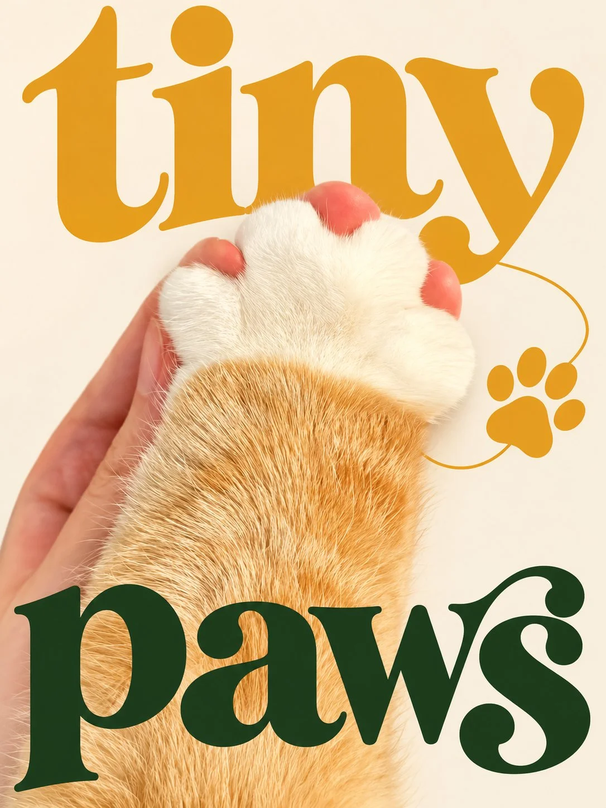

# Playful Brand Editorial Poster With Oversized Serif Words

**中文标题：** 趣味品牌杂志海报（超大小写衬线字）  
**ID:** `gi25-x-1207` · **Mode:** `edit`  
**Categories:** `poster-typography`, `edit-change-preserve`  
**Tags:** `x-twitter`, `community`, `gpt-image-2.5`, `x-direct`, `en`



### Playful Brand Editorial Poster With Oversized Serif Words

```text
UNIVERSAL PROMPT - PLAYFUL BRAND EDITORIAL POSTER | 3:4

Create a premium 3:4 vertical brand poster using the uploaded photograph, featuring [BRAND / SUBJECT / THEME] and the headline [CUSTOM TEXT].

STYLE: Blend vivid photography, expressive lowercase serif lettering, and clean, subject-inspired graphics. Create a playful, bold, sophisticated aesthetic inspired by independent cafés and contemporary lifestyle brands.

SUBJECT: Precisely isolate the main subject while preserving its identity, expression, proportions, colors, patterns, textures, and original artistic style. Keep photographs realistic and characters faithful to their original appearance.

TYPOGRAPHY: Use [CUSTOM TEXT] exactly as provided. Select two key words and transform them into oversized lowercase display serif lettering with rounded curves, elegant thick-and-thin strokes, generous spacing, and flowing terminals. Give each word a distinct dominant color and subtly vary letter proportions for a dynamic silhouette.

COMPOSITION: Position one key word at the top and the other at the bottom, naturally integrating the subject between them. Place the subject slightly off-center, allowing typography and subject contours to interact through subtle foreground-background overlaps. Keep defining features unobstructed and maintain strong visual hierarchy.

GRAPHICS & COLORS: Extract one distinctive motif from the subject and simplify it into a bold solid shape or elegant outline. Connect it subtly to the lettering. Choose two harmonious dominant colors, an optional accent, and a light solid background that complements the subject's original palette.

FINAL FINISH: Balance realistic photographic textures, clean flat graphics, expressive typography, and generous negative space. Add [OPTIONAL SUPPORTING TEXT] only if needed, keeping it minimal.

Avoid bubble lettering, thick black outlines, white sticker borders, image-filled typography, uniform stacked uppercase letters, vintage filters, torn-paper effects, speech bubbles, and repetitive decorations. Do not invent logos or add watermarks.

OUTPUT: One complete, polished poster only, with no mockups or alternate versions.
```

- **Recommended model:** `gpt-image-2.5-sunburst`
- **Settings:** _(defaults)_
- **Source:** [community](https://x.com/Goodmanprotocol/status/2115815163165384861) — @Goodmanprotocol
- **License note:** Original public X post; quoted with attribution — remix with attribution
- **Notes:** Collected directly from X; original post https://x.com/Goodmanprotocol/status/2115815163165384861; post text names GPT Image 2.5; discovered via Bin0754/gpt-image-gallery index, prompt re-verified against the original X post via api.fxtwitter.com; verified=True
- **Preview:** `previews/gi25-x-1207.webp`
