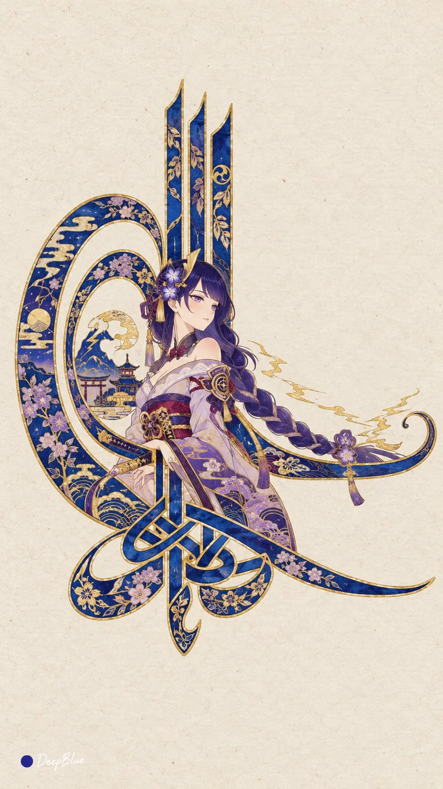

# Ottoman Tughra Calligraphy Seal × Anime Heroines (n=10)

**中文标题：** 奥斯曼花押徽印×动漫游戏女角色（n=10）  
**ID:** `gi25-x-1214` · **Mode:** `generate`  
**Categories:** `poster-typography`, `general`  
**Tags:** `x-twitter`, `community`, `gpt-image-2.5`, `x-direct`, `zh`



### Ottoman Tughra Calligraphy Seal × Anime Heroines (n=10)

```text
动漫或游戏成年女性角色 × 奥斯曼花押式书法 × 角色形态转译 × 纸本钴蓝与金

每张随机选择一位不同的动漫或游戏成年女性角色，提取其清晰可辨的发型、服装、配饰与代表性意象，将发丝、衣袖、裙摆或飘带自然融入花押笔画，形成一枚完整的角色主题徽印。

保留花押骨架：底部交织的书法笔画、三根平行高竖、左侧两层嵌套大椭圆环，以及向右伸展的修长横笔。角色形态与笔画相互连接，整体轮廓清楚，人物保持清晰可辨。

钴蓝粗笔画以金线勾边，笔画和环内部分区域饰以该角色相关的细密纹样。人物及装饰采用统一的奥斯曼宫廷细密画笔法，细线勾勒、平面设色，粗笔画与细纹形成清晰对比。可适量融入角色代表色。

米白色纸本，墨、不透明水彩与金的平面质感。徽印完整可见，周围大面积留白，平整正视。

每张独立抽取角色与相关纹饰，变化角色形态融入方式、徽印比例和画面位置，同批角色与主要组合不重复。

n=10，连续生成10张独立单图，每次生成1张，不拼图、不做宫格或分屏。竖版9:16。左下签名：深蓝色实心圆点在前，白色手写体「DeepBlue」在后。
```

- **Recommended model:** `gpt-image-2.5-sunburst`
- **Settings:** _(defaults)_
- **Source:** [community](https://x.com/DeepBlueX0/status/2115748718553038974) — @DeepBlueX0
- **License note:** Original public X post; quoted with attribution — remix with attribution
- **Notes:** Collected directly from X; original post https://x.com/DeepBlueX0/status/2115748718553038974; post text names GPT Image 2.5; discovered via Bin0754/gpt-image-gallery index, prompt re-verified against the original X post via api.fxtwitter.com; verified=True
- **Preview:** `previews/gi25-x-1214.webp`
