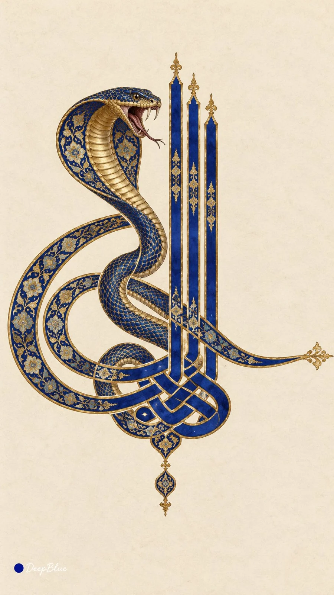

# Ottoman Tughra Calligraphy Seal × Real Animals (n=10)

**中文标题：** 奥斯曼花押徽印×真实动物（n=10）  
**ID:** `gi25-x-1215` · **Mode:** `generate`  
**Categories:** `poster-typography`, `general`  
**Tags:** `x-twitter`, `community`, `gpt-image-2.5`, `x-direct`, `zh`



### Ottoman Tughra Calligraphy Seal × Real Animals (n=10)

```text
真实动物 × 奥斯曼花押式书法 × 动物形态转译 × 纸本钴蓝与金

每张随机选择一种不同的真实动物，提取其清晰可辨的形态特征，将身体曲线、羽翼、尾部或触须自然融入花押笔画，形成一枚完整的动物主题徽印。

保留花押骨架：底部交织的书法笔画、三根平行高竖、左侧两层嵌套大椭圆环，以及向右伸展的修长横笔。动物形态与笔画相互连接，整体轮廓清楚。

钴蓝粗笔画以金线勾边，笔画和环内部分区域饰以该动物相关的细密纹样。动物及装饰采用统一的宫廷细密画笔法，粗笔画与细纹形成清晰对比。

米白色纸本，墨、不透明水彩与金的平面质感。徽印完整可见，周围大面积留白，平整正视。

每张独立抽取动物与相关纹饰，变化动物形态融入方式、徽印比例和画面位置，同批动物与主要组合不重复。

n=10，竖版9:16。左下签名：深蓝色实心圆点在前，白色手写体「DeepBlue」在后。
```

- **Recommended model:** `gpt-image-2.5-sunburst`
- **Settings:** _(defaults)_
- **Source:** [community](https://x.com/DeepBlueX0/status/2115748745539428702) — @DeepBlueX0
- **License note:** Original public X post; quoted with attribution — remix with attribution
- **Notes:** Collected directly from X; prompt posted as the author's own reply https://x.com/DeepBlueX0/status/2115748745539428702 to https://x.com/DeepBlueX0/status/2115748718553038974, which carries the images; GPT Image 2.5 is named in the parent post; discovered via Bin0754/gpt-image-gallery index, prompt re-verified against the original X post via api.fxtwitter.com; verified=True; animal variant posted with its own four example images
- **Preview:** `previews/gi25-x-1215.webp`
