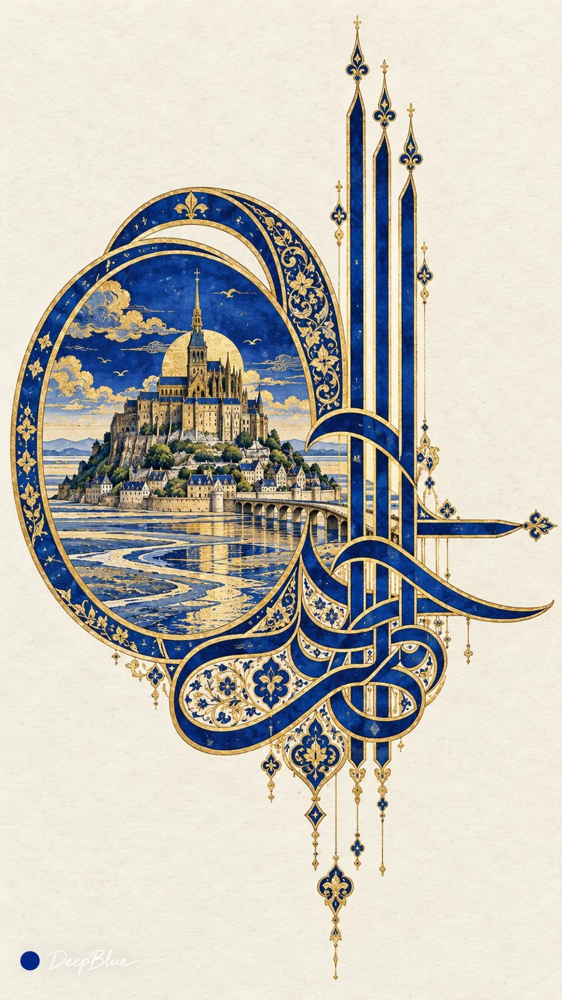

# Ottoman Tughra Calligraphy Seal × World Landmarks (n=10)

**中文标题：** 奥斯曼花押徽印×世界著名建筑（n=10）  
**ID:** `gi25-x-1216` · **Mode:** `generate`  
**Categories:** `poster-typography`, `general`  
**Tags:** `x-twitter`, `community`, `gpt-image-2.5`, `x-direct`, `zh`



### Ottoman Tughra Calligraphy Seal × World Landmarks (n=10)

```text
世界著名建筑 × 奥斯曼花押式书法 × 建筑专属纹饰 × 纸本钴蓝与金

每张随机选择一座不同的真实著名建筑，为它设计一枚专属花押。将建筑绘于左侧环内，保留可辨认的整体轮廓与标志性结构，并提取拱门、窗格或装饰纹样，融入徽印内部。

徽印由底部交织的书法笔画、三根平行高竖、左侧两层嵌套大椭圆环，以及向右伸展的修长横笔组成。各部分连为整体，轮廓清楚。

钴蓝粗笔画以金线勾边，建筑与纹饰采用统一的宫廷细密画笔法。细纹装饰笔画和环内部分区域，保留建筑的辨识度与花押的书法结构。

米白色纸本，墨、不透明水彩与金的平面质感。徽印完整可见，周围大面积留白，平整正视。

每张独立抽取建筑与相关纹饰，变化徽印比例和画面位置，同批建筑与主要组合不重复。

n=10，连续生成10张独立单图，每次生成1张，不拼图、不做宫格或分屏。竖版9:16。左下签名：深蓝色实心圆点在前，白色手写体「DeepBlue」在后。
```

- **Recommended model:** `gpt-image-2.5-sunburst`
- **Settings:** _(defaults)_
- **Source:** [community](https://x.com/DeepBlueX0/status/2115748772219347029) — @DeepBlueX0
- **License note:** Original public X post; quoted with attribution — remix with attribution
- **Notes:** Collected directly from X; prompt posted as the author's own reply https://x.com/DeepBlueX0/status/2115748772219347029 to https://x.com/DeepBlueX0/status/2115748718553038974, which carries the images; GPT Image 2.5 is named in the parent post; discovered via Bin0754/gpt-image-gallery index, prompt re-verified against the original X post via api.fxtwitter.com; verified=True; architecture variant posted with its own four example images
- **Preview:** `previews/gi25-x-1216.webp`
