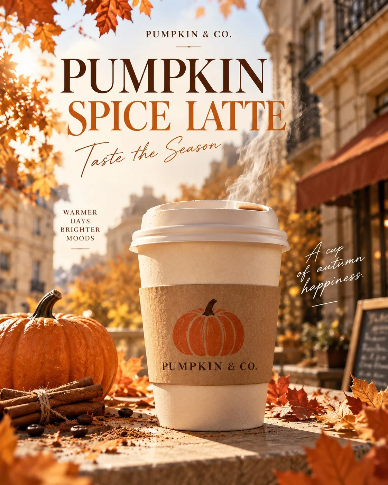

# Pumpkin Spice Latte Autumn Limited Coffee Ad Poster

**中文标题：** 南瓜拿铁秋季限定精品咖啡广告海报  
**ID:** `gi25-x-1217` · **Mode:** `generate`  
**Categories:** `poster-typography`, `ecommerce`  
**Tags:** `x-twitter`, `community`, `gpt-image-2.5`, `x-direct`, `zh`



### Pumpkin Spice Latte Autumn Limited Coffee Ad Poster

```text
生成一张专业商业广告公司设计的精品咖啡品牌秋季限定产品海报，4:5 竖版，高清。

设计风格：现代欧美精品咖啡品牌视觉，Editorial Advertising Design，融合高级杂志排版、真实产品摄影与秋季生活方式美学。

【整体构图】

采用完整的商业平面海报设计，具有明确的字体层级、图文布局、视觉动线和精致留白。

主色调：南瓜橙 #C96932、奶油白 #F5E9D5、深咖啡棕 #35251C。

画面采用上方标题区、中间产品视觉区、下方信息区的三段式布局。

背景是温暖的奶油米色，结合秋日下午阳光、柔和的欧式咖啡馆建筑虚影和少量橙红色枫叶。画面简洁，不堆砌装饰。

【顶部排版】

左上角放置小号品牌标识：
一个简洁的橙色南瓜线条图标
PUMPKIN & CO.

右上角使用小型胶囊形标签：
AUTUMN EDITION
2026

画面上方偏左位置使用超大号、高级复古衬线字体，深咖啡棕色，分两行排版：

FALL IN
LOVE.

标题采用具有明显粗细对比的时尚杂志衬线字体，字母精致，行距紧凑，产生强烈的视觉冲击。

主标题下方增加小号副标题：
YOUR SEASONAL COFFEE RITUAL

【中心产品主视觉】

一杯真实的南瓜拿铁外带热咖啡放置在浅米色石材桌面上。

纸杯米白色，杯身中间环绕真实的牛皮纸杯套，杯套上清晰印有橙色南瓜图案和品牌名称 PUMPKIN & CO.

杯子使用完整闭合的低矮白色塑料外带热饮杯盖，具有真实饮口、凸起边缘和塑料纹理。

杯盖严格保持真实热饮杯盖结构，不出现任何奶油尖顶、冰淇淋、奶泡堆积或裸露咖啡液体。

一缕柔和半透明的白色热气从饮口自然升起，轻盈、细腻。

采用真实商业产品摄影质感，杯子作为视觉中心，体积突出，比例正常，产品清晰锐利。

杯子旁点缀一个小型橙色南瓜、两根肉桂棒和少量自然散落的秋叶。装饰元素保持克制。

左上方温暖阳光照亮纸杯，在桌面形成真实、统一的自然阴影。

【底部商业信息】

在画面底部设置精致的信息排版区，采用清晰的网格布局。

左侧使用较大的现代无衬线字体：

PUMPKIN
SPICE LATTE

下方使用小号文字：
WARM SPICES · SMOOTH ESPRESSO
THE TASTE OF FALL

右下角放置一个精致的南瓜橙色圆形印章，内部清晰写着：

LIMITED
EDITION

底部横向分隔线下方安排品牌广告语：

SIP THE SEASON.

【设计要求】

必须呈现完整的商业海报设计，海报上的标题、副标题、品牌名称、产品名称、广告语和限定标签都要实际生成在画面中。

排版具有专业设计感，字体大小层级鲜明，标题具有明显视觉冲击，产品与文字互不遮挡。

使用专业字体组合：高对比复古衬线字体搭配简洁现代无衬线字体。

保持统一的品牌视觉识别系统，版式精致、有节奏感，留白合理。

所有英文必须正确拼写，文字边缘清晰，避免乱码、错字、重复文字。

画面既有真实摄影的产品质感，又有高级平面设计的商业完成度。

避免普通手机照片、缺少文字的产品摄影、过度复杂的装饰、夸张 CGI、奶油堆顶、冰淇淋形状、假塑料质感、光影错误。

最终效果是一张可以用于咖啡品牌秋季营销活动、社交媒体推广、门店展示的高级商业广告海报。
```

- **Recommended model:** `gpt-image-2.5-sunburst`
- **Settings:** _(defaults)_
- **Source:** [community](https://x.com/Adam38363368936/status/2115716079662338239) — @Adam38363368936
- **License note:** Original public X post; quoted with attribution — remix with attribution
- **Notes:** Collected directly from X; prompt posted as the author's own reply https://x.com/Adam38363368936/status/2115716079662338239 to https://x.com/Adam38363368936/status/2115715556951417000, which carries the images; GPT Image 2.5 is named in the parent post; discovered via Bin0754/gpt-image-gallery index, prompt re-verified against the original X post via api.fxtwitter.com; verified=True
- **Preview:** `previews/gi25-x-1217.webp`
