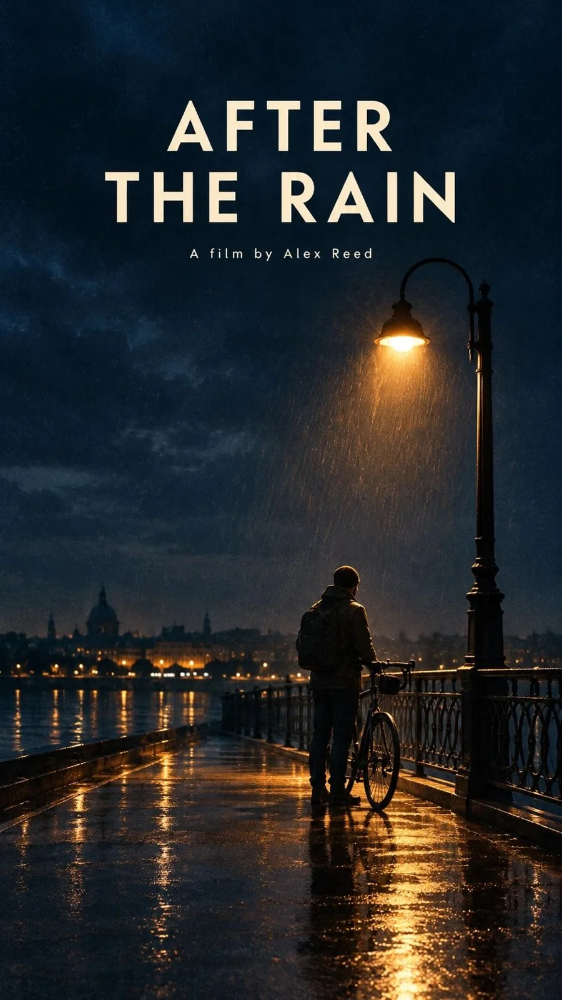

# Indie Film Poster Template ('After the Rain')

**中文标题：** 独立电影海报模板（After the Rain）  
**ID:** `gi25-x-1218` · **Mode:** `generate`  
**Categories:** `poster-typography`  
**Tags:** `x-twitter`, `community`, `gpt-image-2.5`, `x-direct`, `en`



### Indie Film Poster Template ('After the Rain')

```text
Vertical indie film poster. [A lone cyclist] under [a street lamp on a rain-soaked bridge] at night. Navy shadows, amber light, subtle grain. Exact title "[AFTER THE RAIN]" in large cream sans-serif, upper third. Quiet lower edge.
```

- **Recommended model:** `gpt-image-2.5-flare`
- **Settings:** _(defaults)_
- **Source:** [community](https://x.com/LChris430846/status/2115791211206148111) — @LChris430846
- **License note:** Original public X post; quoted with attribution — remix with attribution
- **Notes:** Collected directly from X; prompt posted as the author's own reply https://x.com/LChris430846/status/2115791211206148111 to https://x.com/LChris430846/status/2115791209402621974, which carries the images; GPT Image 2.5 is named in the parent post; discovered via Bin0754/gpt-image-gallery index, prompt re-verified against the original X post via api.fxtwitter.com; verified=True; parent post names GPT Image 2.5 Flare; preview is poster #1
- **Preview:** `previews/gi25-x-1218.webp`
