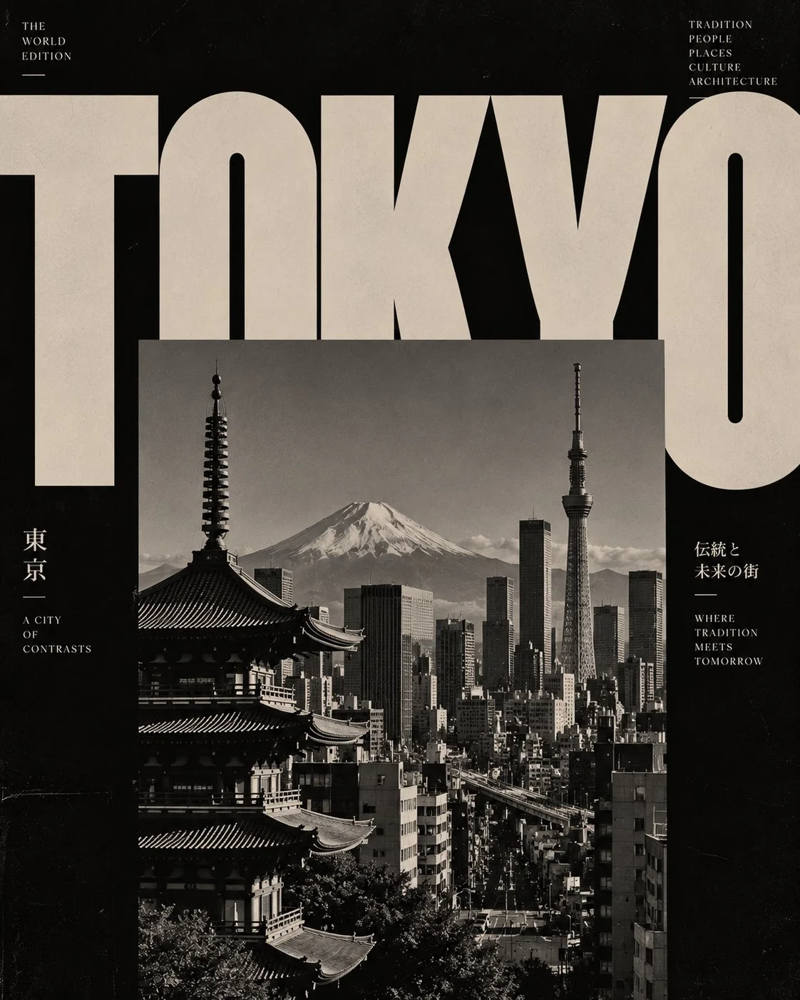

# Swiss Brutalist Architecture Magazine Travel Poster Template

**中文标题：** 瑞士风粗野主义建筑杂志旅行海报模板  
**ID:** `gi25-x-1224` · **Mode:** `generate`  
**Categories:** `poster-typography`, `general`  
**Tags:** `x-twitter`, `community`, `gpt-image-2.5`, `x-direct`, `en`



### Swiss Brutalist Architecture Magazine Travel Poster Template

```text
QCreate a striking, high-fashion architectural editorial poster featuring [CITY / COUNTRY / LANDMARK], inspired by vintage Swiss graphic design, brutalist architecture magazines and experimental typography.

Composition and layout:

* Use an oversized, bold uppercase destination name across the top of the composition.
* Let the typography extend beyond the edges of the canvas, creating dramatic cropping.
* Place a large rectangular black-and-white architectural photograph in the centre, partially overlapping the giant letters.
* Feature the destination’s most recognizable landmark, skyline or architectural structures in the photograph.
* Create an intentional contrast between typography and photography, allowing both elements to interact visually.
* Use a deep black background with warm grey, stone beige or muted ivory lettering.

Typography:
Choose an extremely bold, heavy serif or condensed editorial typeface. Make the destination name the dominant visual element. Experiment with cropped letters, oversized scale and unconventional spacing.

Photography:
Use authentic-looking monochrome architectural photography, dramatic natural shadows, strong geometric lines, deep blacks, subtle film grain and vintage photographic texture.

Art direction:
Minimalist, intellectual, sophisticated, experimental and timeless. Inspired by independent architecture journals and luxury design publications.

Technical composition: Vertical 4:5 format, asymmetrical editorial grid, generous negative space, high contrast, premium print aesthetic.

Important: Keep the landmark recognizable, maintain a clean visual hierarchy, avoid colourful illustrations, decorative graphics, gradients and unnecessary text. The final artwork should look like an exclusive architectural magazine cover rather than a conventional tourist poster.
```

- **Recommended model:** `gpt-image-2.5-sunburst`
- **Settings:** _(defaults)_
- **Source:** [community](https://x.com/Naiknelofar788/status/2116098356749717585) — @Naiknelofar788
- **License note:** Original public X post; quoted with attribution — remix with attribution
- **Notes:** Collected directly from X; original post https://x.com/Naiknelofar788/status/2116098356749717585; post text names GPT Image 2.5; discovered via Bin0754/gpt-image-gallery index, prompt re-verified against the original X post via api.fxtwitter.com; verified=True
- **Preview:** `previews/gi25-x-1224.webp`
