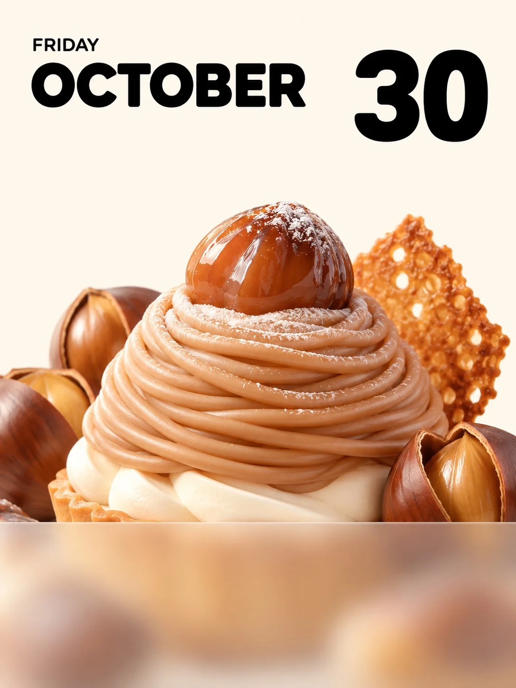

# Soft 3D Dessert Daily Calendar Poster (Mont Blanc)

**中文标题：** 奶油 3D 甜品日签海报·栗子蒙布朗  
**ID:** `gi25-x-1227` · **Mode:** `generate`  
**Categories:** `poster-typography`, `general`  
**Tags:** `x-twitter`, `community`, `gpt-image-2.5`, `x-direct`, `zh`



### Soft 3D Dessert Daily Calendar Poster (Mont Blanc)

```text
Create an image with the following visual system. Replace the subject as specified.

画面风格 Visual system（版式、底色、字体、光感、插画质感，原样保留）:
一张竖幅 3:4 的甜品日签海报，整张是平整的暖奶油白底色，干净无纹理。上方约三分之一大面积留白：左上角用纯黑色、圆润几何感的无衬线字体写一个大号全大写英文月份名，月份名正上方左对齐一行小号、细字重的同款字体全大写英文星期；右上角与月份名同一高度放一个超大号纯黑粗体日期数字，字形饱满醒目。三处文字都清晰锐利、字距舒展，左右边距一致。画面中下部是一份被放大的甜品，主体占据画面下方约三分之二，左右两侧和底边自然出框，顶部高点伸到画面中线附近，主物居中，小配件斜向穿插在两侧形成高低错落。甜品不是照片，而是简化造型的柔和 3D 插画：形体概括成圆润饱满的大体块，细节少而干净，明暗是平滑连续的渐变，表面有糖果和软陶般的蜡润光泽与柔和高光，奶油部分哑光丝滑，略带玩具感但不卡通化，没有描边，也不出现真实食物的细碎颗粒、粗糙纹理和摄影景深。大面积柔光从左上方照入，色温中性偏暖，亮部呈奶白，阴影轻薄柔软，只在物体交叠处加深，没有硬边投影。甜品一直延伸到画面底边，画面下方约五分之二横贯一整块半透明磨砂玻璃面板，上沿是一条水平直线，盖住甜品的下半段，面板后方的甜品被大幅柔化成朦胧的色团，上半部的甜品保持清晰，形成清晰与朦胧的上下对照；磨砂面板上不放任何文字或日历。色彩上暖奶油白占最大面积，甜品自身的颜色集中在中下部，黑色只用于文字。画面中的文字只有这三处：英文星期、英文月份名、日期数字，不要出现日历格、年份、其他数字或文字、品牌、logo、水印、黑色圆形标志或人物。整体干净、清甜、温柔，像一张可以直接当手机壁纸的日签。

主体 New subject（只改这一段）:
一份秋天的烤栗子蒙布朗：栗子奶油挤成一圈圈细长的面条状螺旋，堆成一座圆润的小山，山顶放一颗油亮的糖渍栗子，撒一层薄薄糖粉，底下是一层白色奶油和酥脆塔底；两侧斜插几颗裂开口的带壳烤栗子和一片焦糖色薄脆饼干。主色是栗子棕、焦糖色和奶白。文字：星期写 FRIDAY，月份名写 OCTOBER，日期数字写 30。
```

- **Recommended model:** `gpt-image-2.5-sunburst`
- **Settings:** _(defaults)_
- **Source:** [community](https://x.com/static_stare/status/2116103621045580066) — @static_stare
- **License note:** Original public X post; quoted with attribution — remix with attribution
- **Notes:** Collected directly from X; original post https://x.com/static_stare/status/2116103621045580066; post text names GPT Image 2.5; discovered via Bin0754/gpt-image-gallery index, prompt re-verified against the original X post via api.fxtwitter.com; verified=True; prompt for image 1 of 4 (the author shares the other three on request); preview is image 1
- **Preview:** `previews/gi25-x-1227.webp`
