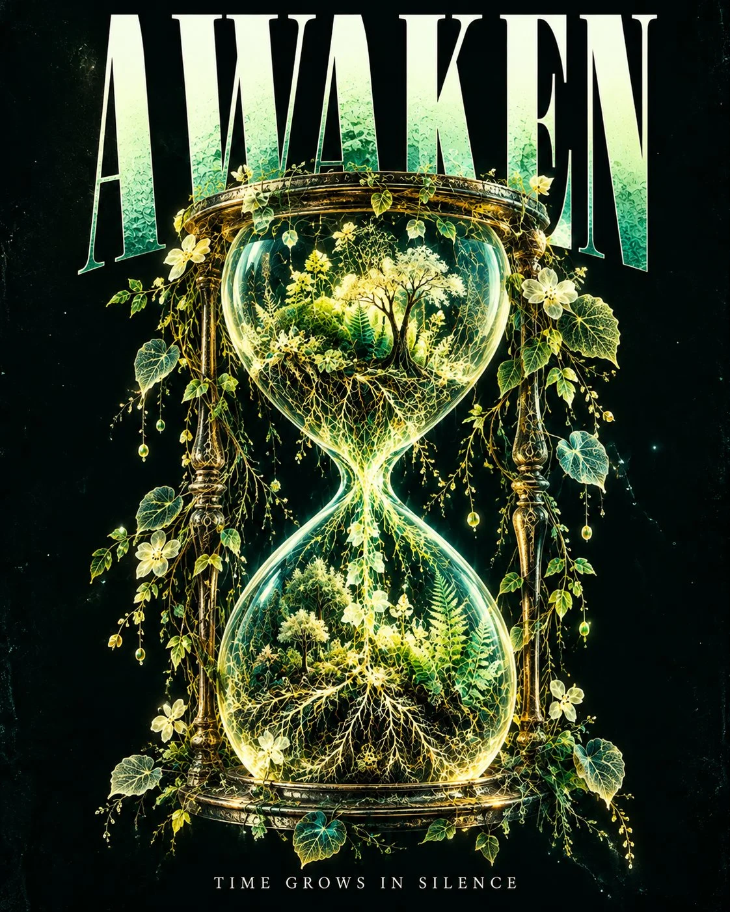

# Botanical X-Ray Organism Editorial Poster Template

**中文标题：** 植物 X 光透视生物编辑海报模板  
**ID:** `gi25-x-1228` · **Mode:** `generate`  
**Categories:** `poster-typography`, `general`  
**Tags:** `x-twitter`, `community`, `gpt-image-2.5`, `x-direct`, `en`



### Botanical X-Ray Organism Editorial Poster Template

```text
[[SUBJECT: Describe any animal, object, creature, anatomical structure or surreal concept, transformed into a translucent botanical organism with glowing internal plant structures, with the main text "YOUR HEADLINE" and subtext "YOUR SHORT EVOCATIVE PHRASE"]] experimental botanical X-ray editorial poster style, extraordinary fusion of vintage radiographic photography and contemporary bioluminescent botanical art, monumental ultra-condensed uppercase typography dominating the upper portion of the composition, elegant minimalist subtitle positioned beneath the central artwork, deep petroleum-black background #061312 with subtle analog photographic grain, central subject reconstructed as a translucent organic specimen revealing intricate internal structures made of glowing botanical veins, delicate vascular networks, microscopic leaf skeletons and fluorescent plant fibers, sophisticated luminous palette of emerald green #00DFA2 electric turquoise #36F5D5 acid yellow #D8FF45 and pale phosphorescent ivory #E8FFE8, extraordinary optical transparency with overlapping translucent layers, delicate internal illumination radiating through organic structures, authentic analog X-ray tonal gradients, intricate biological silhouettes, subtle halation around illuminated edges, extremely fine branching details, dramatic contrast between luminous organic matter and absolute darkness, central subject occupying approximately 70% of the composition, spectacular sculptural presence, elegant asymmetrical balance, intentional negative space, refined contemporary art-book typography, visually arresting experimental photography aesthetic, no additional text, no decorative labels, no logos, no watermark.
```

- **Recommended model:** `gpt-image-2.5-sunburst`
- **Settings:** _(defaults)_
- **Source:** [community](https://x.com/92digitalartArt/status/2116113420269343209) — @92digitalartArt
- **License note:** Original public X post; quoted with attribution — remix with attribution
- **Notes:** Collected directly from X; original post https://x.com/92digitalartArt/status/2116113420269343209; post text names GPT Image 2.5; discovered via Bin0754/gpt-image-gallery index, prompt re-verified against the original X post via api.fxtwitter.com; verified=True
- **Preview:** `previews/gi25-x-1228.webp`
