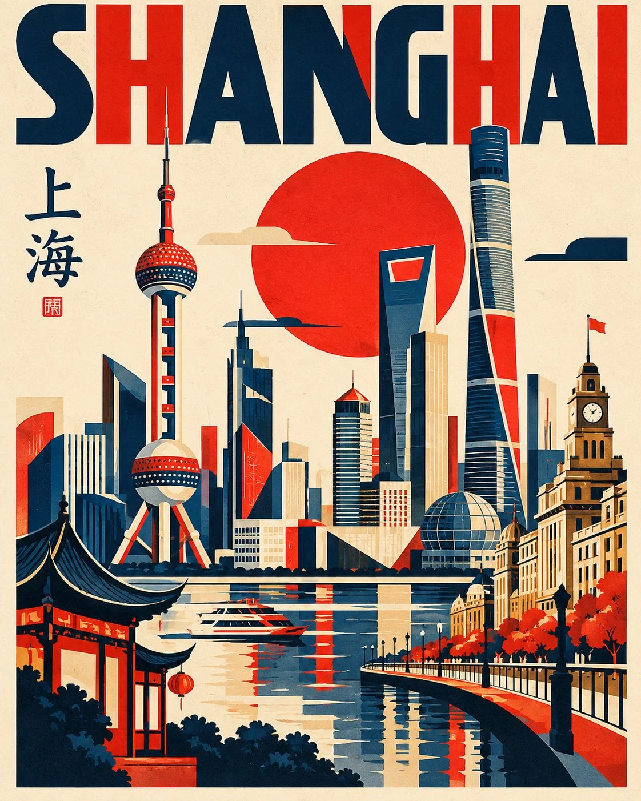

# Bauhaus Geometric Travel Poster Template

**中文标题：** 包豪斯几何旅行海报模板  
**ID:** `gi25-x-1234` · **Mode:** `generate`  
**Categories:** `poster-typography`, `general`  
**Tags:** `x-twitter`, `community`, `gpt-image-2.5`, `x-direct`, `en`



### Bauhaus Geometric Travel Poster Template

```text
Create a striking modernist geometric travel poster featuring [CITY / COUNTRY / LANDMARK], inspired by Bauhaus graphic design, Swiss modernism and contemporary architectural illustration.

1. Main composition
Transform the destination’s most recognizable landmarks into simplified geometric illustrations. Build the artwork using bold rectangles, circles, triangles, arches, vertical lines, semicircles and abstract architectural forms.

2. Landmark integration
Include 2–4 iconic visual elements that genuinely represent the selected destination, such as:

* Famous towers, monuments and architectural structures.
* Traditional rooftops, temples, bridges or domes.
* Mountains, rivers, coastlines or distinctive landscapes.
* Recognizable cultural symbols and local design motifs.

3. Geometric visual language

* Break architecture into bold geometric blocks.
* Use overlapping shapes and carefully balanced patterns.
* Incorporate circles as suns, moons or architectural elements.
* Create abstract representations of landmarks while preserving their recognizable silhouettes.
* Arrange elements like an intricate modernist graphic-design puzzle.

4. Colour palette
Use a sophisticated limited palette of:

* Deep navy blue.
* Vibrant vermilion red.
* Warm ivory or cream.
* Optional muted ochre or charcoal accents.

5. Typography
Integrate the destination name prominently into the composition using bold uppercase sans-serif lettering. Experiment with horizontal, vertical and oversized typography.

Include the destination’s local script where appropriate, ensuring correct spelling and authentic characters.

6. Composition and finish
Create a tightly arranged but visually balanced vertical 4:5 poster. Use a warm cream background, crisp flat colours, sharp edges, clean vector-like shapes and a premium matte print texture.

Overall aesthetic: Retro-modern, Bauhaus-inspired, intellectual, graphic, architectural, playful and timeless.

Important: Make the destination instantly recognizable through its authentic landmarks and cultural details. Avoid photorealism, gradients, 3D effects, excessive decoration and unnecessary text. The final result should look like a collectible contemporary design poster from an international graphic-art exhibition.
```

- **Recommended model:** `gpt-image-2.5-sunburst`
- **Settings:** _(defaults)_
- **Source:** [community](https://x.com/Naiknelofar788/status/2116165079830036863) — @Naiknelofar788
- **License note:** Original public X post; quoted with attribution — remix with attribution
- **Notes:** Collected directly from X; original post https://x.com/Naiknelofar788/status/2116165079830036863; post text names GPT Image 2.5; discovered via Bin0754/gpt-image-gallery index, prompt re-verified against the original X post via api.fxtwitter.com; verified=True
- **Preview:** `previews/gi25-x-1234.webp`
