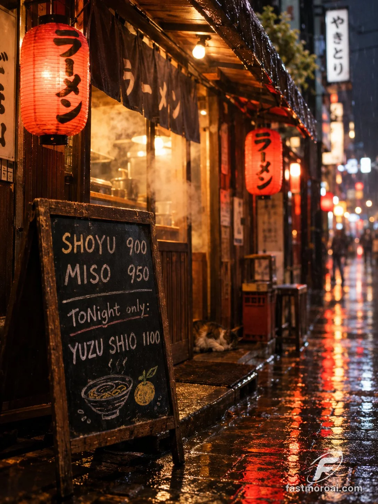

# Rainy Tokyo Ramen Stall Chalkboard Menu (Text-Casing Trap)

**中文标题：** 雨夜东京拉面摊黑板菜单（大小写陷阱测试）  
**ID:** `gi25-x-1238` · **Mode:** `generate`  
**Categories:** `poster-typography`, `general`  
**Tags:** `x-twitter`, `community`, `gpt-image-2.5`, `x-direct`, `en`



### Rainy Tokyo Ramen Stall Chalkboard Menu (Text-Casing Trap)

```text
A hand-painted chalkboard menu outside a tiny ramen stall on a rainy night in Tokyo. The board reads exactly: "SHOYU 900 / MISO 950 / TONight only: YUZU SHIO 1100". Steam drifting from the stall, red paper lanterns reflected in wet cobblestones, a cat sleeping under the awning. 35mm photo, shallow depth of field, warm tungsten light.
```

- **Recommended model:** `gpt-image-2.5-sunburst`
- **Settings:** _(defaults)_
- **Source:** [community](https://x.com/FastMoroAI/status/2116190429917958229) — @FastMoroAI
- **License note:** Original public X post; quoted with attribution — remix with attribution
- **Notes:** Collected directly from X; prompt posted as the author's own reply https://x.com/FastMoroAI/status/2116190429917958229 to https://x.com/FastMoroAI/status/2116190137331700209, which carries the images; GPT Image 2.5 is named in the parent post; discovered via Bin0754/gpt-image-gallery index, prompt re-verified against the original X post via api.fxtwitter.com; verified=True; comparison post: same prompt on Nano Banana 2.1 (image 1) and GPT Image 2.5 (image 2); preview is image 2
- **Preview:** `previews/gi25-x-1238.webp`
