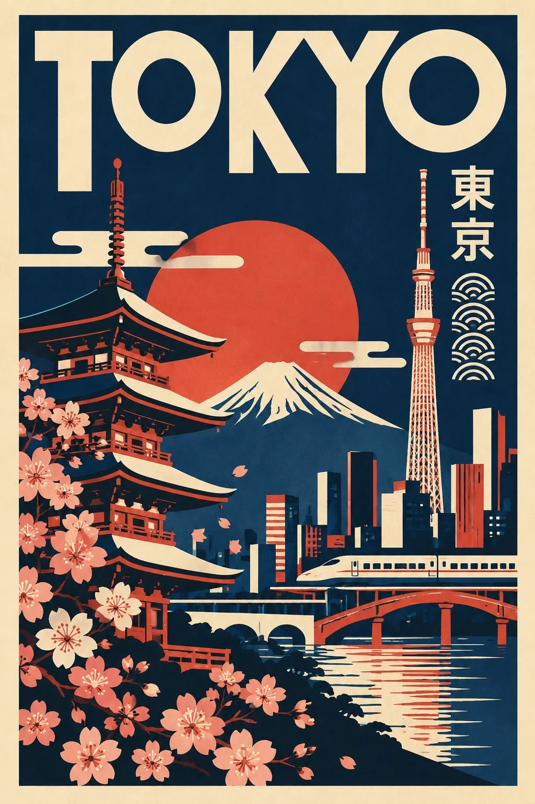

# Mid-Century Minimalist Symbolic Travel Poster Template

**中文标题：** 中世纪现代极简符号旅行海报模板  
**ID:** `gi25-x-1243` · **Mode:** `generate`  
**Categories:** `poster-typography`, `general`  
**Tags:** `x-twitter`, `community`, `gpt-image-2.5`, `x-direct`, `en`



### Mid-Century Minimalist Symbolic Travel Poster Template

```text
Create a striking minimalist retro travel poster featuring [CITY / COUNTRY / LANDMARK], inspired by mid-century modern graphic design, vintage cultural posters, abstract geometric art and ancient symbolic illustration.

1. Overall composition

Create a vertical 2:3 poster with a clean, flat graphic-design aesthetic. Use a large solid-colour background surrounded by a contrasting outer border.

2. Destination typography

Display the destination name prominently across the top in oversized, bold, geometric uppercase lettering. Typography should feel artistic, distinctive and inspired by the visual identity of the location.

3. Cultural symbols and illustrations

Incorporate 3–5 simplified graphic elements that genuinely represent the selected destination, such as:

* Recognizable architectural landmarks.
* Traditional cultural symbols, patterns or motifs.
* Local plants, flowers, animals or natural elements.
* Famous mountains, rivers, deserts or coastlines.
* Historic objects, decorative symbols or regional art forms.

Arrange these elements as separate artistic compositions rather than realistic scenes.

4. Landscape illustration

Use simplified geometric mountain ranges, architectural silhouettes, rolling hills, desert dunes, coastlines or other location-specific landscapes.

Include a small silhouette of a locally relevant animal, tree or other distinctive element in the foreground where appropriate.

5. Graphic style

* Flat vector-style illustrations.
* Bold geometric shapes and clean outlines.
* Abstract symbolic artwork.
* Strong negative space.
* Minimalist silhouettes.
* Smooth curves and angular patterns.
* Subtle vintage print texture.
* No photorealism or 3D effects.

6. Unique colour identity

IMPORTANT: Select a completely different, destination-inspired colour palette for every new poster.

Do not automatically reuse the same colours. Choose 3–5 harmonious colours inspired by the location’s natural landscape, architecture, cultural heritage, traditional textiles or regional identity.

Use one dominant background colour, one contrasting illustration colour, one accent colour and a warm neutral for secondary details.

7. Final presentation

Premium collectible travel-art poster, vertical 2:3 format, balanced composition, bold typography, sophisticated colour blocking, clean geometric illustrations and timeless vintage graphic-design aesthetics.

Important: Make every poster visually unique while maintaining the same overall design language. Use authentic destination-specific symbols, accurate local script where appropriate, and correctly spelled destination names. Avoid generic decorative symbols that do not belong to the selected location.
```

- **Recommended model:** `gpt-image-2.5-sunburst`
- **Settings:** _(defaults)_
- **Source:** [community](https://x.com/Naiknelofar788/status/2116402481995583602) — @Naiknelofar788
- **License note:** Original public X post; quoted with attribution — remix with attribution
- **Notes:** Collected directly from X; original post https://x.com/Naiknelofar788/status/2116402481995583602; post text names GPT Image 2.5; discovered via Bin0754/gpt-image-gallery index, prompt re-verified against the original X post via api.fxtwitter.com; verified=True
- **Preview:** `previews/gi25-x-1243.webp`
