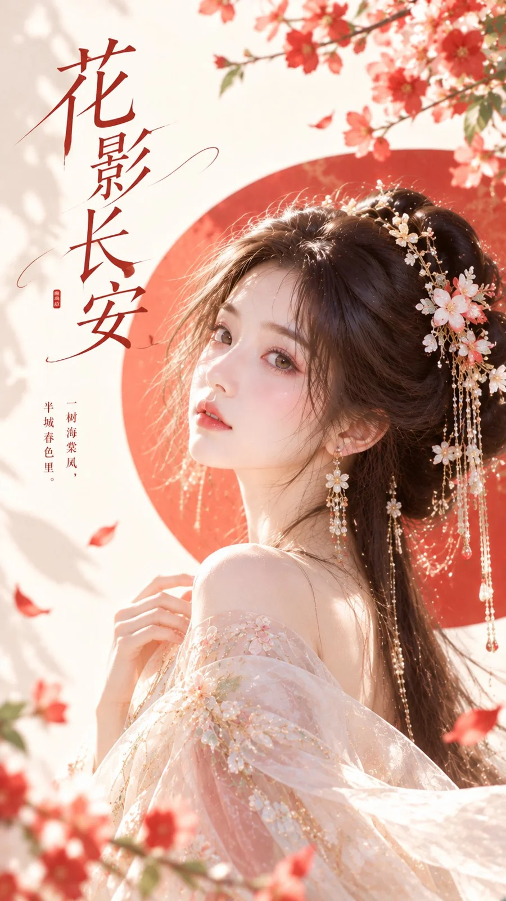

# Coral-Red Circle New Chinese Beauty Cover Poster

**中文标题：** 花影·珊瑚红圆形色块东方美学封面  
**ID:** `gi25-x-1245` · **Mode:** `generate`  
**Categories:** `poster-typography`, `general`  
**Tags:** `x-twitter`, `community`, `gpt-image-2.5`, `x-direct`, `zh`



### Coral-Red Circle New Chinese Beauty Cover Poster

```text
主题方向：东方禅意极简爆款封面
风格分支：女性审美精致抓眼型
主体内容：一位古风女子上半身近景，微微回眸，耳饰和侧脸线条清晰可见
情绪母题：明艳、柔美、精致吸引力
场景与意象：珊瑚红背景圆形色块、浅金耳饰高光、象牙白背景、女子
构图与空间：9:16竖版构图，人物靠近中部偏一侧，圆形色块位于人物后方形成主视觉支撑，顶部与另一侧保留整洁留白
色彩控制：象牙白作为整体基底，珊瑚红用于背景圆形色块和少量局部点睛，浅金用于耳饰与小面积高光，人物服装建议珍珠白；避免整图泛红
光线与质感：明亮柔光，肤色通透，耳饰与轮廓边缘清晰，现代东方人像封面质感
画幅比例：9:16
补充要求：人物脸部必须漂亮、柔和、有记忆点，整体封面感强，适合女性向高传播首图，画面留白处配上合适的文字
```

- **Recommended model:** `gpt-image-2.5-sunburst`
- **Settings:** _(defaults)_
- **Source:** [community](https://x.com/liyue_ai/status/2116424522106892797) — @liyue_ai
- **License note:** Original public X post; quoted with attribution — remix with attribution
- **Notes:** Collected directly from X; original post https://x.com/liyue_ai/status/2116424522106892797; post text names GPT Image 2.5; discovered via Bin0754/gpt-image-gallery index, prompt re-verified against the original X post via api.fxtwitter.com; verified=True
- **Preview:** `previews/gi25-x-1245.webp`
