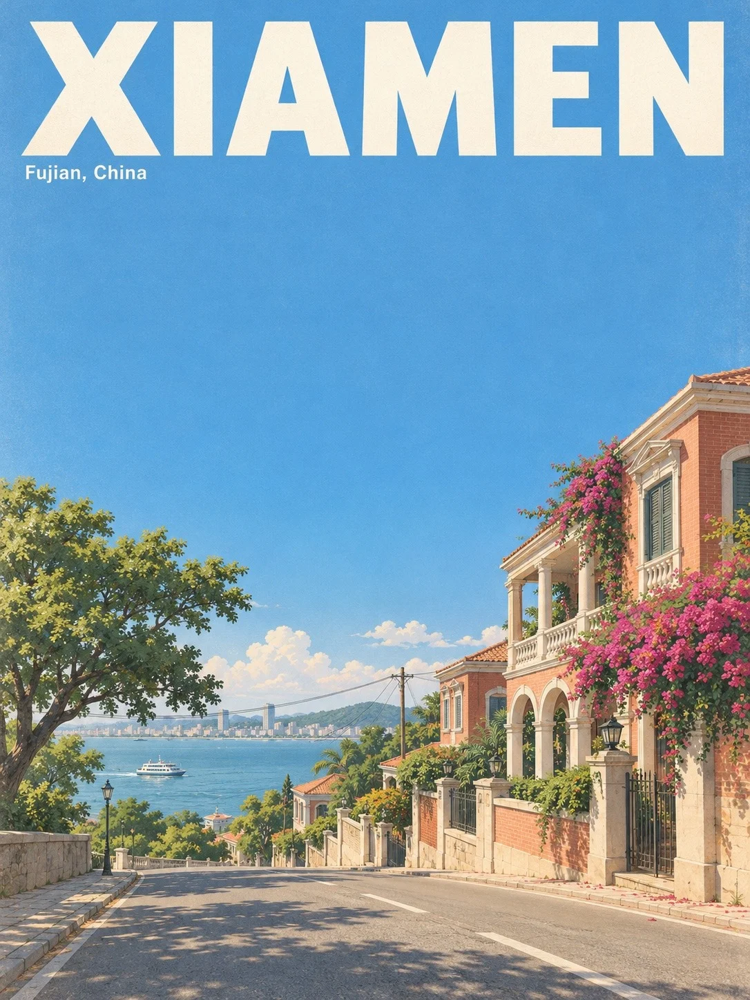

# Japanese Flat-Color City Travel Poster

**中文标题：** 日系平涂城市旅行海报  
**ID:** `gi25-x-1248` · **Mode:** `generate`  
**Categories:** `poster-typography`, `general`  
**Tags:** `x-twitter`, `community`, `gpt-image-2.5`, `x-direct`, `zh`



### Japanese Flat-Color City Travel Poster

```text
Create an image with the following visual system. Replace the subject as specified.

Visual system (light, color, composition, medium, mood):
一张竖幅 3:4 的日系复古旅行海报，日式平涂插画加干净的动画背景绘景。清澈的蓝天占画面上方约三分之二，是一大块连续留白，最多只有地平线附近几朵低矮的小积云，电线只在下部少量横穿。画面最顶部是一行超大的白色无衬线全大写英文地名，横贯画面宽度，字距舒展，四周留出安全边距；地名下方左侧紧贴一行很小的白色英文小字。画面中只有这两处文字，拼写必须完全准确，不要其他任何文字、汉字、日文、店招、招牌字、门牌、品牌、商标、徽章、路牌文字或坐标数字。下方约三分之一是当地的街景：街对面平视、略广角的远景机位，地平线压到画面下方四分之一附近，前景是带浅色标线的灰褐路面，中景偏右是当地有特色的低层建筑，左侧开阔，远景露出一窄条水面和低矮的山或岸线，建筑和远景形成不对称平衡；一两件生活细节（车、自行车、树、船）给画面一点人气，不让任何一个物件压倒画面。夏末下午暖白的阳光从左上方照进来，受光面明亮柔和，向右下投出清晰但不生硬的影子，暗部带灰青色环境光。颜色秩序：略灰的天蓝约六成半，铺满天空和水面；米白、浅暖灰约两成半，给标题、建筑亮面和道路；深橄榄绿、灰青绿约百分之八，给树和局部暗面；赭黄和低饱和砖红只占约百分之二点缀街道细节。平涂色块、克制的渐变、简洁透视，轮廓干净，细节适度概括，覆一层极细的纸纹和轻微褪色印刷感，不要厚重做旧，不要写实照片感，不要粗黑描边。整体安静、晴朗、慢，像一个没什么安排的夏天下午。

New subject:
顶部大字地名为 XIAMEN，下方小字为 Fujian, China。街景是鼓浪屿的一条安静坡道：右侧是两三栋红砖拱廊老洋楼，带白色廊柱和百叶窗，墙头垂下一大丛玫红色三角梅，坡道左侧开阔，远处是一窄条海面和一艘小小的白色渡轮，对岸是低矮的城市天际线，路边一棵大榕树。
```

- **Recommended model:** `gpt-image-2.5-sunburst`
- **Settings:** _(defaults)_
- **Source:** [community](https://x.com/static_stare/status/2116435108580261968) — @static_stare
- **License note:** Original public X post; quoted with attribution — remix with attribution
- **Notes:** Collected directly from X; original post https://x.com/static_stare/status/2116435108580261968; post text names GPT Image 2.5; discovered via Bin0754/gpt-image-gallery index, prompt re-verified against the original X post via api.fxtwitter.com; verified=True; prompt for image 1 of 4 (the author shares the other three on request); preview is image 1
- **Preview:** `previews/gi25-x-1248.webp`
