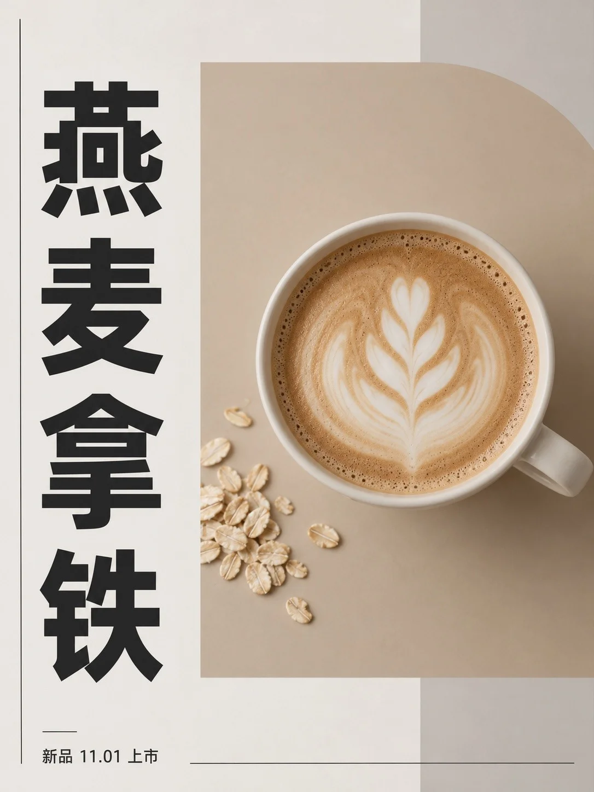

# Minimal Magazine-Style Event Poster

**中文标题：** 极简杂志感活动海报  
**ID:** `gi25-x-1251` · **Mode:** `generate`  
**Categories:** `poster-typography`  
**Tags:** `x-twitter`, `community`, `gpt-image-2.5`, `x-direct`, `zh`



### Minimal Magazine-Style Event Poster

```text
Create an image with the following visual system. Replace the subject as specified.

Visual system (light, color, composition, medium, mood):
一张完整独立的竖幅 3:4 极简编辑设计海报，铺满整个画布，正面平视、无透视变形，像一张印好平放的杂志感海报原稿，不是模板拼贴，不是展示墙，不出现海报外的场景、相框或样机。底色是暖灰白哑光纸面，大面积留白。一块低饱和主色的大矩形占据画面中部偏右约四成面积，边缘被画面裁切，局部配一段裁切的圆弧；主色块里放一张同色调、低饱和、安静的主体照片，照片被色块完整裁成矩形，和色块融为一体。左侧是一个近黑色的超大中文主标题，纵向竖排，字少而大，粗壮的黑体，字形端正、笔画完整；画面底部左侧一行很小的横排说明文字，和竖排标题形成方向对照。版式用清晰的非对称网格，两三条极细的近黑分隔线和一两根短横线放在边缘和底部，所有元素精确对齐。画面中的文字只有主标题和底部那一行小字两处，逐字准确，不要任何其他文字、伪文字、乱码小字段落、页码、英文品牌名、商标或标识。颜色秩序：暖灰白纸底约一半，主色块约三成半到四成，浅雾灰辅助分区约一成，近黑只用于文字和细线约百分之六，不额外引入鲜艳强调色。光线是中性略暖的均匀漫射光，只在左上角有极轻的明度变化，没有投影、浮雕或立体效果。细微纸纤维、平整哑光油墨、锐利字缘，克制、安静、理性，有出版物的秩序感，不要做旧噪点。

New subject:
主题是咖啡新品海报。主色块是低饱和的燕麦奶咖色。色块里的照片是俯拍的一杯燕麦拿铁，白色陶瓷杯，奶泡上一个简单的拉花，旁边一小撮燕麦粒。竖排主标题为四个字「燕麦拿铁」，底部小字为「新品 11.01 上市」。
```

- **Recommended model:** `gpt-image-2.5-sunburst`
- **Settings:** _(defaults)_
- **Source:** [community](https://x.com/static_stare/status/2116465453929312560) — @static_stare
- **License note:** Original public X post; quoted with attribution — remix with attribution
- **Notes:** Collected directly from X; original post https://x.com/static_stare/status/2116465453929312560; post text names GPT Image 2.5; discovered via Bin0754/gpt-image-gallery index, prompt re-verified against the original X post via api.fxtwitter.com; verified=True; prompt for image 1 of 4 (the author shares the other three on request); preview is image 1
- **Preview:** `previews/gi25-x-1251.webp`
