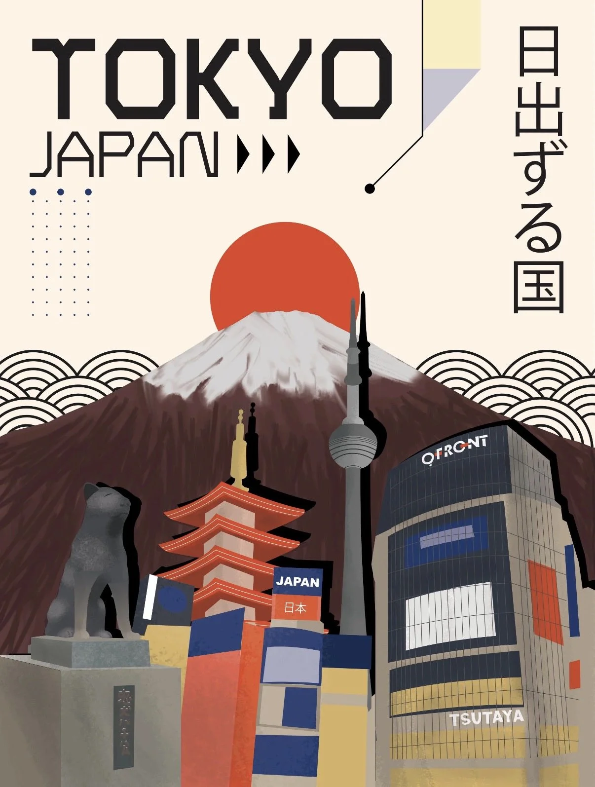

# Japanese-Swiss Editorial Travel Poster Template

**中文标题：** 日式×瑞士编辑风旅行海报模板  
**ID:** `gi25-x-1257` · **Mode:** `generate`  
**Categories:** `poster-typography`, `general`  
**Tags:** `x-twitter`, `community`, `gpt-image-2.5`, `x-direct`, `en`



### Japanese-Swiss Editorial Travel Poster Template

```text
Create an extraordinary contemporary editorial travel poster featuring [CITY / COUNTRY / LANDMARK], inspired by modern Japanese graphic design, Swiss typography, minimalist architecture, Bauhaus geometry and sophisticated cultural illustration.

1. Overall composition
Create a vertical 2:3 art poster with a warm, softly textured background and a clean, modern editorial layout.

Build the composition using overlapping architectural elements, geometric patterns, abstract shapes and carefully arranged cultural details.

2. Typography and destination identity
Display the destination name in oversized, bold geometric uppercase typography at the top.
Add the country name beneath it in a smaller, elegant modern sans-serif font.
Incorporate authentic local-language typography vertically along one side where appropriate.
Use small arrows, lines, dots, geometric markers and editorial annotations as supporting design elements.
Make typography an important visual part of the artwork rather than simply a caption.

3. Iconic landmarks
Feature 3–5 recognizable elements representing the destination.

Include a combination of:
Its most famous architectural landmark.
Traditional architecture, temples, towers, monuments or buildings.
Recognizable modern skyline or structures.
Cultural symbols, local animals, flowers or traditional objects.
Distinctive geographical features such as mountains, coastlines or rivers.

Arrange the landmarks in overlapping layers, creating an artistic architectural collage with different scales and perspectives.

4. Signature graphic elements
Incorporate:
A large geometric sun or circular shape behind the landscape.
Repeating waves, arches or semicircular patterns.
Abstract geometric blocks and colour panels.
Delicate dotted grids and thin connecting lines.
Stylized mountain ranges or landscape silhouettes.
Small cultural illustrations integrated naturally into the composition.

5. Destination-specific colour palette
CRITICAL: Generate a unique colour identity for every destination.

Do not reuse a fixed colour combination across all posters.
Automatically select 4–6 harmonious colours inspired by the actual location’s:

Natural landscape and climate.
Traditional architecture and cultural heritage.
Regional textiles, crafts and artistic traditions.
Local flowers, vegetation, water and surrounding scenery.

Use one dominant background colour, one primary contrasting colour, one or two architectural accent colours and a complementary neutral.

6. Artistic direction

Contemporary Japanese editorial illustration.
Swiss modernist graphic design.
Flat geometric shapes combined with subtly detailed architectural illustration.
Strong visual hierarchy.
Sophisticated colour blocking.
Clean lines and carefully balanced negative space.
Subtle paper grain and premium matte print texture.
Modern, artistic and culturally distinctive.

7. Final presentation

Vertical 2:3 collectible travel-art poster, sophisticated typography, layered landmark composition, elegant cultural details, visually striking colour combinations and premium international graphic-design aesthetic.

Important: Preserve the architectural identity of actual landmarks. Use genuine destination-specific symbols and correctly spelled names. Every new destination should have its own visual personality while maintaining the same overall editorial design language. Avoid generic tourist imagery, photorealism, excessive decoration and unnecessary text.
```

- **Recommended model:** `gpt-image-2.5-sunburst`
- **Settings:** _(defaults)_
- **Source:** [community](https://x.com/Naiknelofar788/status/2116504517797937513) — @Naiknelofar788
- **License note:** Original public X post; quoted with attribution — remix with attribution
- **Notes:** Collected directly from X; original post https://x.com/Naiknelofar788/status/2116504517797937513; post text names GPT Image 2.5; discovered via Bin0754/gpt-image-gallery index, prompt re-verified against the original X post via api.fxtwitter.com; verified=True
- **Preview:** `previews/gi25-x-1257.webp`
