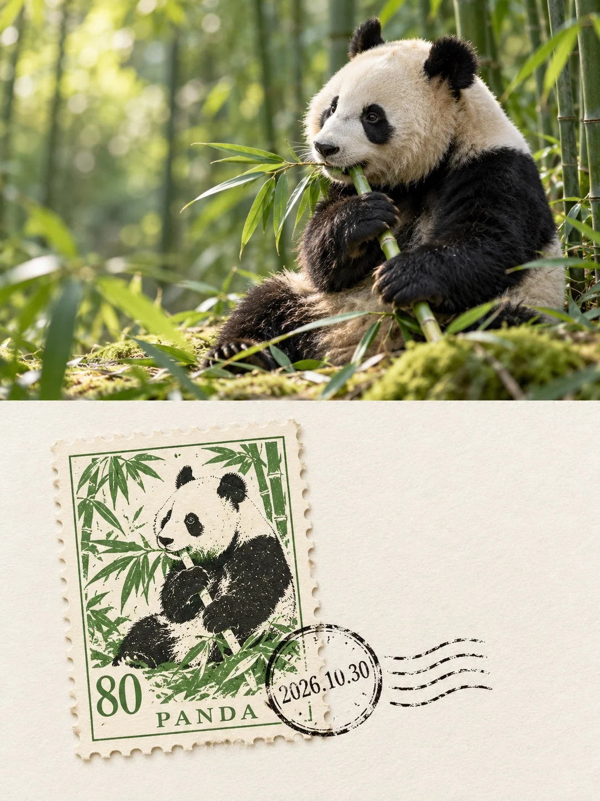

# Wildlife Photo Over Three-Color Printed Stamp

**中文标题：** 野生动物照片×三色套印邮票  
**ID:** `gi25-x-1264` · **Mode:** `generate`  
**Categories:** `poster-typography`, `general`  
**Tags:** `x-twitter`, `community`, `gpt-image-2.5`, `x-direct`, `zh`



### Wildlife Photo Over Three-Color Printed Stamp

```text
Create an image with the following visual system. Replace the subject as specified.

Visual system (light, color, composition, medium, mood):
一张竖幅 3:4 双段式作品，上下两个区域高度各占一半，齐边衔接，不加分隔线。上半部是野生动物自然摄影：接近主体视线高度的中近景，长焦压缩、浅景深，主体清晰并略偏一侧、朝向另一侧留出空间，前景少量枝叶或草茎局部出框，背景化成柔软的大块散景。柔和日光从左上方照入，色温中性略暖，亮部温润，暗部保留环境色的深层次，反差适中，毛发或羽毛的细纹清楚。下半部切换为俯拍纸品静物：大面积极浅的暖奶白纤维纸面，干净明亮，只放一枚小小的竖向齿孔纪念邮票，宽度约占下半部画面的三分之一，偏左放置并轻微逆时针旋转，其余大片留白。邮票把上方同一只动物的轮廓、姿态和朝向转译成彩色套印版画：只用从这只动物身上提取的三种颜色加奶白纸底，提纯为鲜明的专色油墨分色套印，色块边缘轻微错位，带细碎露白、网点和油墨颗粒，票面有一圈细边框。邮票左下角印一个衬线面值数字，底边印一行全大写英文单词。一枚深色圆形邮戳半压在邮票右下角，一半落在票面、一半落在纸上，圈内只写日期 2026.10.30，旁边带三四条波浪线，墨色有断墨和压力不均。齿孔边缘有细小缺口，在纸面投下轻薄短影。画面中的文字只有这三处：面值数字、底边英文单词、邮戳日期，不要出现其他任何文字、品牌或人物。整体明亮、干净、克制，有收藏感；避免灰脏做旧、满版纹理、多枚邮票堆叠和广告文案。

New subject:
上半部：一只野生大熊猫坐在竹林里的苔藓坡地上，侧身偏右、头朝左，双手抱着一根新鲜竹枝在啃，黑白毛色干净分明，背景是深浅不一的竹林绿散景，前景几片竹叶出框。下半部邮票：用竹叶绿、墨黑、奶白三色套印这只抱竹子的熊猫，竹叶衬底。面值数字为 80，底边英文单词为 PANDA。
```

- **Recommended model:** `gpt-image-2.5-sunburst`
- **Settings:** _(defaults)_
- **Source:** [community](https://x.com/static_stare/status/2116144775489315087) — @static_stare
- **License note:** Original public X post; quoted with attribution — remix with attribution
- **Notes:** Collected directly from X; original post https://x.com/static_stare/status/2116144775489315087; post text names GPT Image 2.5; discovered via X search, prompt re-verified against the original X post via api.fxtwitter.com; verified=True; prompt for image 1 of 4 (the author shares the other three on request); preview is image 1
- **Preview:** `previews/gi25-x-1264.webp`
