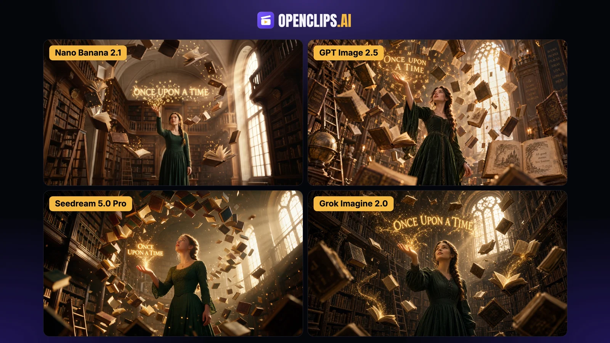

# Floating Library Books Spelling 'Once Upon a Time'

**中文标题：** 图书馆悬浮书本魔法字 Once Upon a Time  
**ID:** `gi25-x-1275` · **Mode:** `generate`  
**Categories:** `poster-typography`, `general`  
**Tags:** `x-twitter`, `community`, `gpt-image-2.5`, `x-direct`, `en`



### Floating Library Books Spelling 'Once Upon a Time'

```text
Cinematic film still, 16:9, wide low-angle shot. A young woman in a long dark green dress, hair in a loose braid, stands in the center of a grand old library with towering wooden bookshelves, rolling ladders and a tall arched window. She raises her right hand, palm up. Hundreds of old leather-bound books float around her in a slow spiral, some open with pages fluttering, and glowing golden letters rise from the pages like sparks. Above her open hand the golden letters gather into the clearly legible words "ONCE UPON A TIME". Warm sunbeams pour through the window, dust glittering in the air, golden glow lighting her calm, amazed face. Shot on 35mm film, shallow depth of field, rich warm color grade, highly detailed.
```

- **Recommended model:** `gpt-image-2.5-sunburst`
- **Settings:** _(defaults)_
- **Source:** [community](https://x.com/openclipsai/status/2116457190244470959) — @openclipsai
- **License note:** Original public X post; quoted with attribution — remix with attribution
- **Notes:** Collected directly from X; prompt posted as the author's own reply https://x.com/openclipsai/status/2116457190244470959 to https://x.com/openclipsai/status/2116457046295957796, which carries the images; GPT Image 2.5 is named in the parent post; discovered via X search, prompt re-verified against the original X post via api.fxtwitter.com; verified=True; comparison post (Nano Banana 2.1 / GPT Image 2.5 / Seedream 5.0 Pro / Grok Imagine 2.0); preview is the parent post image
- **Preview:** `previews/gi25-x-1275.webp`
