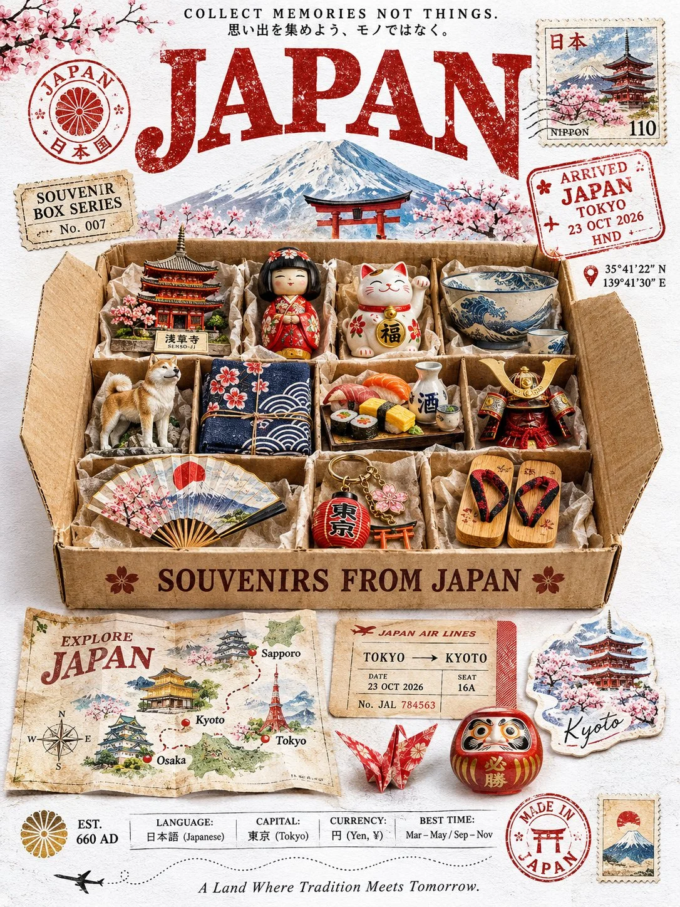

# Vintage Country Travel Poster With Postal Memorabilia

**中文标题：** 复古国家旅行海报×邮政收藏  
**ID:** `gi25-x-1290` · **Mode:** `generate`  
**Categories:** `poster-typography`, `general`  
**Tags:** `x-twitter`, `community`, `gpt-image-2.5`, `x-direct`, `en`



### Vintage Country Travel Poster With Postal Memorabilia

```text
UNIVERSAL PROMPT - VINTAGE COUNTRY TRAVEL POSTER | 3:4

Create an ultra-realistic vintage travel poster for {{COUNTRY}}, combining retro travel advertising, postal memorabilia, and a nostalgic magazine-cover aesthetic. Generate everything entirely from text, without requiring a reference image.

Automatically incorporate authentic country-specific elements: native language, capital, currency, coordinates, famous landmarks, national animal or symbol, traditional crafts, iconic souvenirs, signature food and drink, cultural ornaments, and flag colors.

BACKGROUND & TYPOGRAPHY

Use a pure white (#FFFFFF) matte paper background with subtle paper grain and barely visible aging. Keep it white, without cream, beige, yellow, or sepia tones.

At the top, add "COLLECT MEMORIES NOT THINGS." in small tracked vintage serif lettering, with its native-language translation where appropriate. Below, display {{COUNTRY}} in oversized distressed brick-red (#B5432E) vintage slab-serif typography with authentic worn letterpress texture.

VINTAGE POSTAL DETAILS

Add a circular national-symbol rubber stamp and a "SOUVENIR BOX SERIES" postal tag on the left. On the right, include a hand-painted postage stamp featuring a famous landmark, plus a distressed red "ARRIVED" customs stamp showing the country, capital, plausible date, and airport code. Include accurate capital coordinates.

CENTRAL SOUVENIR BOX

Feature a large open kraft-cardboard shipping box in the center, viewed from a gentle top-down angle. Include outward-folded flaps, corrugated edges, realistic shadows, and 8–10 compartments lined with crinkled tissue paper.

Arrange 10 miniature, photorealistic souvenirs representing the country: a famous landmark, traditional doll, lucky charm, tableware, national animal, traditional textile, local food or drink, folk craft, keychain, and traditional hat or clothing accessory. Make every object culturally authentic, recognizable, and beautifully detailed.

Add "SOUVENIRS FROM {{COUNTRY}}" in vintage dark-brown lettering on the front flap.

BOTTOM TRAVEL COLLAGE

Below the box, arrange:

- A folded illustrated map titled "EXPLORE {{COUNTRY}}", featuring 3–4 destinations, dotted travel routes, landmark illustrations, and a compass rose.
- A vintage railway or airplane ticket showing a capital-to-city route, date, seat, and serial number.
- A die-cut travel sticker depicting an iconic national landmark.
- One small traditional folk-craft object.

COUNTRY INFORMATION FOOTER

Add a small national-symbol badge and a historical founding year where applicable. Include a neatly arranged information strip:

LANGUAGE: [NATIVE LANGUAGE] | CAPITAL: [CITY] | CURRENCY: [CURRENCY] | BEST TIME: [SEASON]

Finish with a circular "MADE IN {{COUNTRY}}" stamp, miniature national-symbol postage stamp, tiny airplane with a dashed flight path, and the national motto in small italic lettering.

VISUAL STYLE & QUALITY

Use restrained national flag colors, realistic paper fibers, distressed ink, hand-painted illustrations, natural contact shadows, soft studio lighting, and slightly desaturated vintage colors. Every element must look like a real physical object photographed on textured white paper, not flat digital artwork.

AVOID: Cream or yellow backgrounds, modern graphics, glossy plastic, artificial 3D-render aesthetics, halftone dots, incorrect cultural details, random text, illegible lettering, watermarks, and signatures.

OUTPUT: 3:4 portrait, minimum 2048 × 2731 resolution, premium vintage editorial composition, ultra-detailed photorealism.
```

- **Recommended model:** `gpt-image-2.5-sunburst`
- **Settings:** _(defaults)_
- **Source:** [community](https://x.com/Goodmanprotocol/status/2116772434754097586) — @Goodmanprotocol
- **License note:** Original public X post; quoted with attribution — remix with attribution
- **Notes:** Collected directly from X; original post https://x.com/Goodmanprotocol/status/2116772434754097586; post text names GPT Image 2.5; discovered via X search, prompt re-verified against the original X post via api.fxtwitter.com; verified=True
- **Preview:** `previews/gi25-x-1290.webp`
