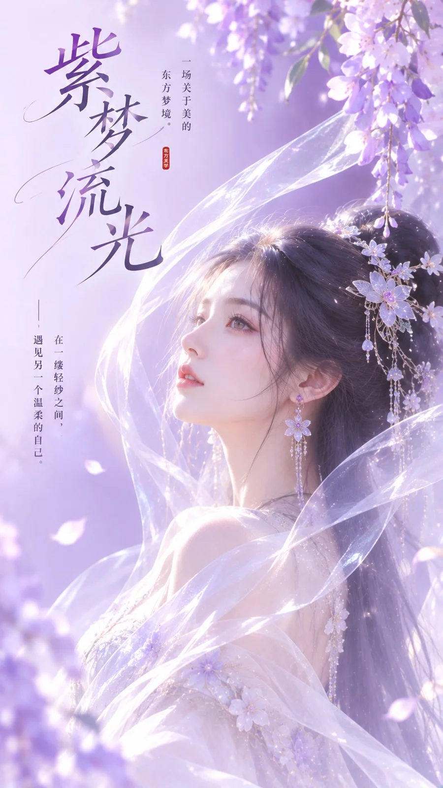

# Lavender Veil New Chinese Beauty Cover Poster

**中文标题：** 紫梦流光·薰衣草轻纱东方封面  
**ID:** `gi25-x-1291` · **Mode:** `generate`  
**Categories:** `poster-typography`, `general`  
**Tags:** `x-twitter`, `community`, `gpt-image-2.5`, `x-direct`, `zh`



### Lavender Veil New Chinese Beauty Cover Poster

```text
主题方向：东方禅意极简爆款封面
风格分支：女性审美梦幻型
主体内容：一位古风女子侧身站立，半透明轻纱从肩侧绕过脸旁，露出清晰侧颜
情绪母题：梦感、柔美、克制浪漫
场景与意象：薰衣草紫背景、冰白轻纱、女子、少量浅银高光
构图与空间：9:16竖版构图，人物位于中下部偏一侧，轻纱向上延展形成柔和动线，上方和另一侧保留足够标题区
色彩控制：冰白作为人物与轻纱的主要基底，薰衣草紫用于背景主色块，浅银用于极少量高光点缀；避免背景整体灰紫化
光线与质感：柔亮清透的漫射光，轻纱半透明但边缘清晰，整体低灰度、干净梦幻
画幅比例：9:16
补充要求：人物侧颜要美，轻纱要轻盈高级，整体要像女性向梦感封面，但不能脏灰，画面留白处添加合适的文字
```

- **Recommended model:** `gpt-image-2.5-sunburst`
- **Settings:** _(defaults)_
- **Source:** [community](https://x.com/liyue_ai/status/2116784311366291596) — @liyue_ai
- **License note:** Original public X post; quoted with attribution — remix with attribution
- **Notes:** Collected directly from X; original post https://x.com/liyue_ai/status/2116784311366291596; post text names GPT Image 2.5; discovered via X search, prompt re-verified against the original X post via api.fxtwitter.com; verified=True
- **Preview:** `previews/gi25-x-1291.webp`
