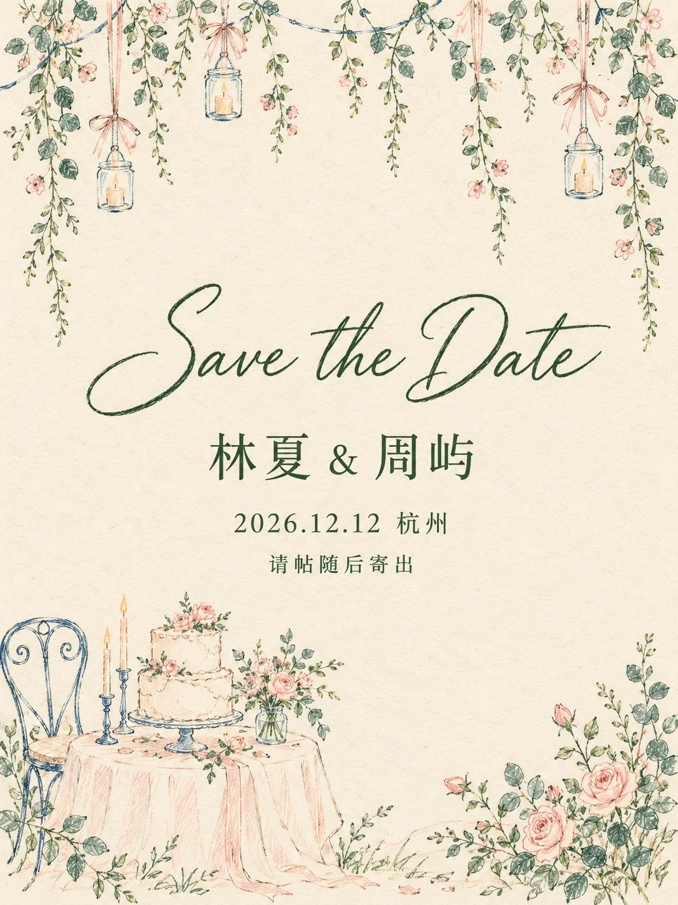

# Hand-Drawn Colored-Pencil Save-the-Date Card

**中文标题：** 彩铅手绘 Save the Date 邀请卡  
**ID:** `gi25-x-1297` · **Mode:** `generate`  
**Categories:** `poster-typography`  
**Tags:** `x-twitter`, `community`, `gpt-image-2.5`, `x-direct`, `zh`



### Hand-Drawn Colored-Pencil Save-the-Date Card

```text
Create an image with the following visual system. Replace the subject as specified.

Visual system (light, color, composition, medium, mood):
一张完整独立的竖幅 3:4 活动邀请卡，正面平视、平面全幅呈现，卡面铺满整个画布，不是样机，不出现桌面、信封、手或卡片外的场景。底是暖奶油米白的纸，带细微纤维、浅颗粒和一点点不均匀，像在左上方偏暖的柔和漫射日光下，亮度均匀，没有投影。插画只放在卡片上下两条边：上边是从顶部垂下来的一排疏落装饰，两侧斜插少量花叶；下边偏左是一组桌面或场景小景，右下角一丛低矮花草呼应，上下两组都要轻、要疏，中间留出一大块连续的纸色空白。插画全部是略带颤动、偶尔断笔的彩色铅笔加细墨线手绘线稿，基本不填色，物体内部透出纸底，只用稀疏短线提示褶皱和结构，线宽有轻重变化，不要光滑均匀的矢量描边、水彩晕染、厚涂或写实阴影。文字全部居中排在中轴上：偏上是一行深森林绿的优雅英文连笔手写体大标题，下面依次是一行中号的中文名称行、一行小号的中文时间地点行、一行更小的中文附语，四处文字字号逐级变小，行距疏朗，中文用清秀端正的宋体，笔画完整、逐字准确；除这四处外画面里没有任何其他文字、伪文字、签名、商标或水印。颜色秩序：暖奶油纸底约八成五；深森林绿用于全部文字和植物枝叶约六分；柔和钴蓝只画结构性的线（椅背、灯串、架子、桌腿之类）约四分；浅蜜桃色画布料、纸灯、蛋糕这类柔软物件约四分；玫粉只点在少量花朵上约一分，不再加入其他颜色。整体轻盈、亲切、有呼吸感，带一点复古纸品的味道。

New subject:
主题是婚礼预告卡。上边垂下几串细藤蔓，中间挂着三四只小玻璃烛台，系着蜜桃色的细丝带。下边偏左是一张铺着桌布的小圆桌，上面一只两层的婚礼蛋糕和一小束花，右下角是一丛玫瑰和尤加利叶。文字：英文手写大标题「Save the Date」；名称行「林夏 & 周屿」；时间地点行「2026.12.12 杭州」；附语「请帖随后寄出」。
```

- **Recommended model:** `gpt-image-2.5-sunburst`
- **Settings:** _(defaults)_
- **Source:** [community](https://x.com/static_stare/status/2116825793712042458) — @static_stare
- **License note:** Original public X post; quoted with attribution — remix with attribution
- **Notes:** Collected directly from X; original post https://x.com/static_stare/status/2116825793712042458; post text names GPT Image 2.5; discovered via X search, prompt re-verified against the original X post via api.fxtwitter.com; verified=True; prompt for image 1 of 4 (the author shares the other three on request); preview is image 1
- **Preview:** `previews/gi25-x-1297.webp`
