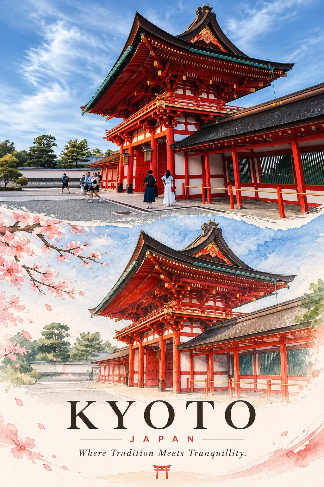

# Split Photo-and-Illustration Travel Artwork Template

**中文标题：** 照片×插画分屏旅行艺术模板  
**ID:** `gi25-x-1310` · **Mode:** `generate`  
**Categories:** `poster-typography`, `general`  
**Tags:** `x-twitter`, `community`, `gpt-image-2.5`, `x-direct`, `en`



### Split Photo-and-Illustration Travel Artwork Template

```text
Create an extraordinary split-composition travel artwork featuring [CITY / COUNTRY / LANDMARK], combining realistic luxury travel photography with a beautifully illustrated artistic interpretation of the same destination.

1. Overall composition

Create a vertical 2:3 premium travel-art poster divided into two visually connected horizontal sections.

UPPER HALF — THE REAL WORLD

Show an exceptionally beautiful, photorealistic travel photograph of [LANDMARK / DESTINATION].

* Capture the landmark from a breathtaking architectural perspective.
* Use authentic surroundings, natural landscapes and recognizable local details.
* Incorporate beautiful natural daylight, realistic shadows and atmospheric depth.
* Make the photograph look like it was taken by a professional luxury travel photographer.
* Preserve accurate architectural proportions, materials and original colours.
* Create a peaceful, cinematic and immersive atmosphere.

LOWER HALF — THE ARTISTIC WORLD

Transform the exact same landmark and surroundings into an elegant artistic illustration.

Choose an artistic style that complements the destination, such as:

* Minimalist architectural line drawing.
* Watercolour landscape illustration.
* Vintage travel-poster artwork.
* Japanese-inspired flat graphic illustration.
* Delicate ink and pencil sketch.
* Contemporary geometric architectural art.

Preserve the landmark’s recognizable silhouette while simplifying its surroundings into beautiful artistic shapes, textures and details.

2. Connection between both worlds

The transition between the photograph and illustration should feel intentional and visually harmonious.

The upper photograph and lower artwork must depict the SAME location, landmark, viewing angle and composition.

Allow architectural lines, landscape shapes, reflections or natural elements to visually continue from one half into the other.

3. Destination-specific colour palette

Automatically select a beautiful colour palette inspired by the destination.

The illustrated lower half may reinterpret the colours of the original photograph using complementary artistic tones, while maintaining visual harmony between both sections.

4. Typography

Display [DESTINATION NAME] in elegant, bold uppercase typography near the bottom.

Add a beautiful destination-inspired tagline beneath it.

Examples:

* JAPAN — Where Tradition Meets Tranquillity.
* ITALY — Beauty Beyond Time.
* EGYPT — Where History Lives Forever.
* KASHMIR — A Paradise Painted by Nature.
* PARIS — An Eternal Work of Art.

Keep the typography refined, minimal and beautifully spaced.

5. Final artistic direction

Luxury travel editorial, photorealistic architectural photography, fine-art illustration, sophisticated split composition, seamless visual storytelling, beautiful natural lighting, premium print texture and exceptional detail.

Technical format: Vertical 2:3 composition, high resolution, collectible gallery-quality travel artwork.

IMPORTANT: The upper section must be genuinely photorealistic, not illustrated. The lower section must be visibly artistic, not another photograph. Both sections must represent the same destination and landmark. Avoid unrelated scenery, mismatched perspectives, excessive typography and clutter.
```

- **Recommended model:** `gpt-image-2.5-sunburst`
- **Settings:** _(defaults)_
- **Source:** [community](https://x.com/Naiknelofar788/status/2116903435555783073) — @Naiknelofar788
- **License note:** Original public X post; quoted with attribution — remix with attribution
- **Notes:** Collected directly from X; original post https://x.com/Naiknelofar788/status/2116903435555783073; post text names GPT Image 2.5; discovered via X search, prompt re-verified against the original X post via api.fxtwitter.com; verified=True
- **Preview:** `previews/gi25-x-1310.webp`
