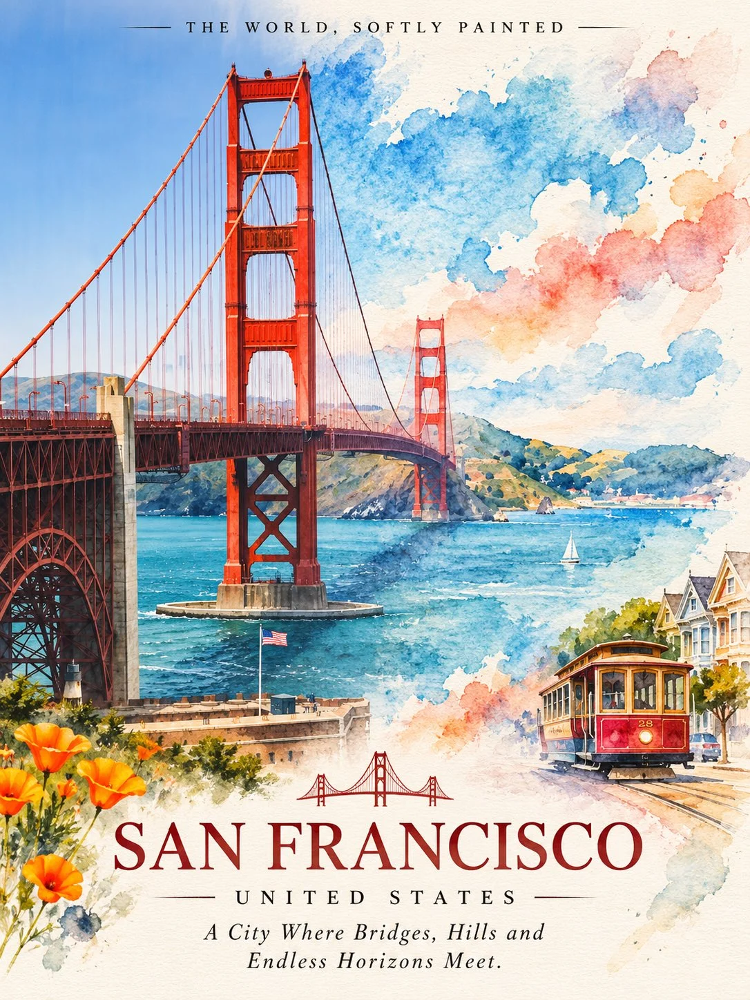

# Photo-and-Watercolor Split Travel Poster

**中文标题：** 摄影×水彩分屏旅行海报  
**ID:** `gi25-x-1318` · **Mode:** `generate`  
**Categories:** `poster-typography`, `general`  
**Tags:** `x-twitter`, `community`, `gpt-image-2.5`, `x-direct`, `en`



### Photo-and-Watercolor Split Travel Poster

```text
THE WORLD IN WATERCOLOR — Where Photography Becomes Art

Create an extraordinarily beautiful luxury travel artwork featuring [CITY / COUNTRY / LANDMARK / NATURAL DESTINATION], combining breathtaking photorealistic landscape photography with delicate, flowing watercolour painting.

1. Overall composition

Create a sophisticated horizontal split composition in a vertical 4:5 or 2:3 art-print format.

LEFT HALF — THE WORLD AS IT IS

Show a breathtaking, photorealistic photograph of the destination.

* Capture its most recognizable natural landscape or architectural landmark.
* Include authentic surroundings, local vegetation and geographical details.
* Use beautiful natural daylight, realistic reflections and atmospheric depth.
* Preserve genuine colours, textures and architectural details.
* Create a professional luxury travel-photography aesthetic.

RIGHT HALF — THE WORLD IN WATERCOLOR

Transform the exact same scene into a beautiful flowing watercolour painting.

* Recreate the same mountain peaks, architecture, forests, lake or landscape.
* Use delicate transparent watercolour washes.
* Allow pigments to flow naturally beyond the edges of the scene.
* Incorporate soft colour bleeding, organic brushstrokes and layered pigments.
* Create beautiful watercolour textures on warm ivory handmade paper.
* Allow parts of the landscape to dissolve gently into abstract washes.
* Preserve the recognizable silhouette of the original destination.

2. The magical transition

Create a delicate vertical transition between photography and watercolour.

The landscape should appear to gradually transform from a real photograph into a hand-painted masterpiece.

Allow trees, mountain peaks, reflections and architectural details to continue naturally across both halves.

Avoid an overly rigid dividing line. Use flowing pigments and subtle paper textures to create an organic transition.

3. Destination identity — THE UNIQUE SIGNATURE

IMPORTANT: Include 2–4 authentic elements that make the selected destination instantly recognizable beyond its main landmark.

Automatically select culturally and geographically relevant detail
Integrate these elements naturally into the composition rather than adding them as unrelated decorations.

4. Flowing watercolour palette

Select a unique destination-inspired palette for every artwork.

Use soft, transparent pigments, subtle colour gradients and naturally blending tones.

The watercolour side should feel light, dreamy, atmospheric and beautifully expressive.

5. Typography and destination name

Add the destination name in elegant, refined uppercase typography near the bottom.

[DESTINATION NAME]

Below it, include a poetic, original tagline inspired by the place.

6. Artistic direction

Luxury travel photography, flowing watercolour illustration, handmade cotton paper texture, organic pigment blooms, delicate brushwork, atmospheric landscapes, sophisticated editorial composition and fine-art gallery aesthetics.

7. Final presentation

Premium collectible travel-art poster, vertical 2:3 composition, photorealistic and watercolour split, elegant typography, authentic destination details and exceptional artistic craftsmanship.
```

- **Recommended model:** `gpt-image-2.5-sunburst`
- **Settings:** _(defaults)_
- **Source:** [community](https://x.com/Naiknelofar788/status/2117102383419576396) — @Naiknelofar788
- **License note:** Original public X post; quoted with attribution — remix with attribution
- **Notes:** Collected directly from X; original post https://x.com/Naiknelofar788/status/2117102383419576396; post text names GPT Image 2.5; discovered via X search, prompt re-verified against the original X post via api.fxtwitter.com; verified=True
- **Preview:** `previews/gi25-x-1318.webp`
