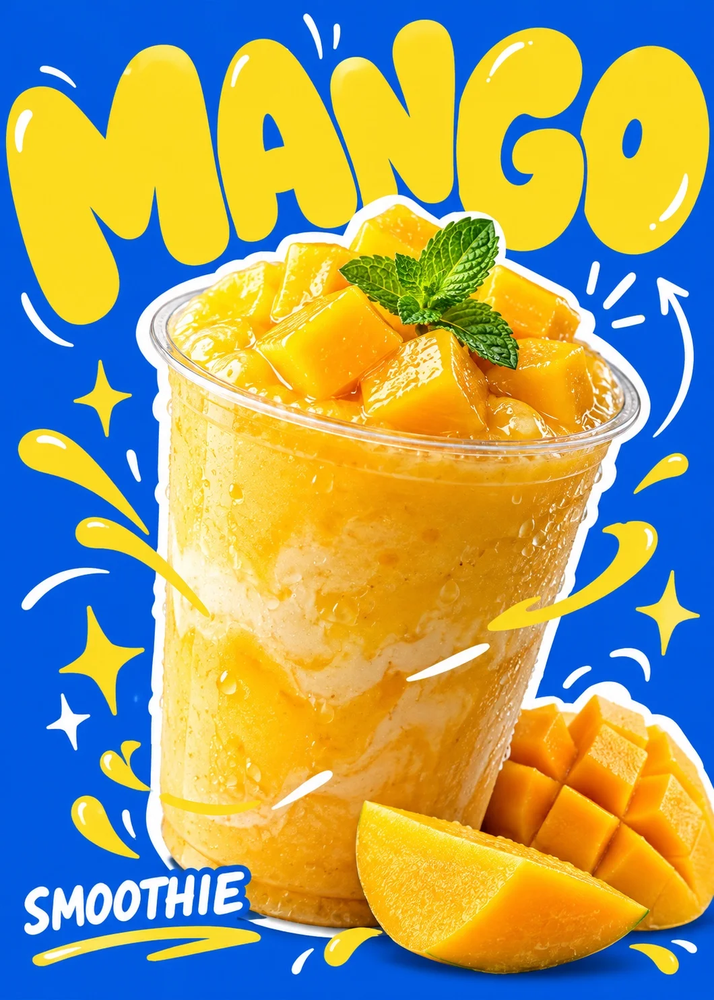

# Chunky-Type Drink Poster with Photo Collage: Mango Smoothie

**中文标题：** 粗字体饮料海报·摄影拼贴芒果冰沙  
**ID:** `gi25-x-1331` · **Mode:** `generate`  
**Categories:** `poster-typography`, `ecommerce`  
**Tags:** `x-twitter`, `community`, `gpt-image-2.5`, `x-direct`, `zh`



### Chunky-Type Drink Poster with Photo Collage: Mango Smoothie

```text
Create an image with the following visual system. Replace the subject as specified.

Visual system (light, color, composition, medium, mood):
一张单张竖版餐饮产品海报（约 5:7），写实食品摄影剪贴与平面字体设计混合。正面略俯视的近景产品摄影，可替换饮品居中偏下、占画面高度约六成，轻微倾斜，以不规则白色粗描边剪贴在纯色平面背景上。左上方中性偏冷大面积柔光照亮杯身，保留透明杯壁细小反光、凝露与饮品颗粒；背景不做真实空间投影。上半部以厚重、圆钝、略不规则的展示字体堆叠产品英文名，下半部用超大口味字穿插于杯身后方，字母轻微旋转、紧密挤压并局部出血；左下三行重复短副标题只出现设定文案，右上可有小型抽象字标。前景少量手绘曲线、星芒、闪电与箭头，局部跨过杯身，边角辅以裁切花瓣色块，保留呼吸间隙。每张限定两至三种平面设计色（由 New subject 指定），产品保留自然色。所有文字必须与 New subject 完全一致，不出现真实品牌、吉祥物或原图文字。热闹、俏皮、年轻甜品店语气。

New subject:
产品是一杯芒果冰沙，透明塑料杯，上面堆着芒果果肉块和一片薄荷叶，杯底旁边摆着两块切好的芒果。配色：底色亮宝蓝，大字芒果黄，涂鸦用白色和芒果黄。文字：超大圆胖字「MANGO」；小号重复副标「SMOOTHIE」（只出现一次，可三行重复同一词）。
```

- **Recommended model:** `gpt-image-2.5-sunburst`
- **Settings:** _(defaults)_
- **Source:** [community](https://x.com/static_stare/status/2117188824329588835) — @static_stare
- **License note:** Original public X post; quoted with attribution — remix with attribution
- **Notes:** Collected directly from X; original post https://x.com/static_stare/status/2117188824329588835; post text names GPT Image 2.5; discovered via X search, prompt re-verified against the original X post via api.fxtwitter.com; verified=True; prompt for image 1 of 4 (the author shares the other three on request); preview is image 1
- **Preview:** `previews/gi25-x-1331.webp`
