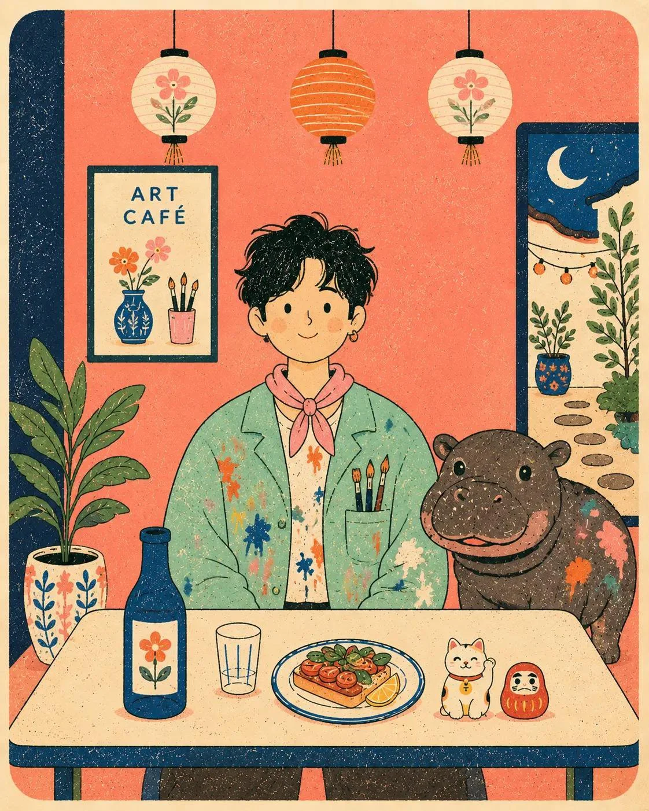

# Risograph Café-Table Poster Template (Human + Animal)

**中文标题：** 孔版印刷风咖啡桌海报模板（人物+动物）  
**ID:** `gi25-x-1338` · **Mode:** `generate`  
**Categories:** `poster-typography`, `general`  
**Tags:** `x-twitter`, `community`, `gpt-image-2.5`, `x-direct`, `en`



### Risograph Café-Table Poster Template (Human + Animal)

```text
Flat modern risograph-style poster illustration of [HUMAN], wearing [CLOTHING], sitting front-facing behind a simple café table with [ANIMAL] in [SCENERY]. Use [COLORS] as flat solid color blocks on warm cream paper, with simple black hand-drawn outlines, naive proportions, minimal facial features, tiny dash textures, visible speckled print grain, slightly imperfect registration, clean graphic shapes, playful folk-poster composition, and a calm centered layout. The background is [BACKGROUND], simplified into flat wall shapes, one framed poster, one window shape, one potted plant, and a few rounded hanging lanterns. Keep the table objects simple: one bottle, one glass, one plate of food, and two tiny charms. Rounded cream border, retro Japanese picture-book poster feel, aspect ratio 4:5.
```

- **Recommended model:** `gpt-image-2.5-sunburst`
- **Settings:** _(defaults)_
- **Source:** [community](https://x.com/Maercihh/status/2117218060767727844) — @Maercihh
- **License note:** Original public X post; quoted with attribution — remix with attribution
- **Notes:** Collected directly from X; original post https://x.com/Maercihh/status/2117218060767727844; post text names GPT Image 2.5; discovered via X search, prompt re-verified against the original X post via api.fxtwitter.com; verified=True
- **Preview:** `previews/gi25-x-1338.webp`
