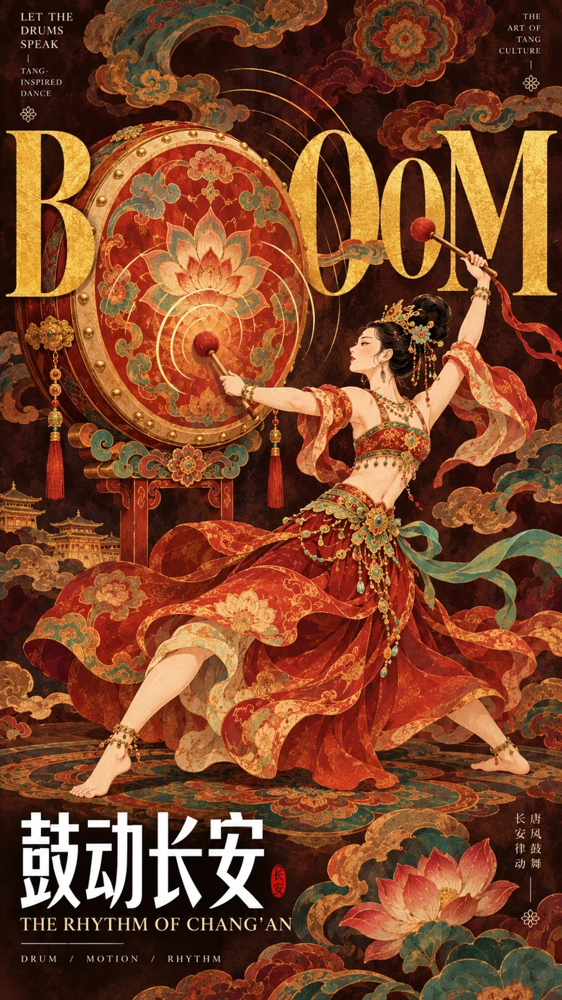

# Dunhuang Dance × Giant Editorial Typography Poster Template

**中文标题：** 敦煌舞×巨型英文字排版海报模板  
**ID:** `gi25-x-1349` · **Mode:** `generate`  
**Categories:** `poster-typography`  
**Tags:** `x-twitter`, `community`, `gpt-image-2.5`, `x-direct`, `en`



### Dunhuang Dance × Giant Editorial Typography Poster Template

```text
Create a premium 9:16 vertical poster blending Dunhuang-inspired Chinese dance art with bold contemporary editorial typography.

Customize
Theme: [Dance / Music / Cultural Theme]  
Characters: [1–3 dancers, pose and interaction]  
Key Visual: [Drum / Fan / Circular Formation / Giant Letters / Other]  
Giant English Type: [WORD]  
Chinese Headline: [中文标题]  
Subtitle: [English Subtitle]  
Color Palette: [Main Colors]

Feature elegant Tang-inspired adult dancers with dynamic poses, graceful anatomy, ornate hairstyles, jewelry, flowing garments, and richly decorated traditional costumes.

Use saturated mineral colors such as cinnabar red, turquoise, jade green, indigo, ivory, and antique gold against a deep dark background.

Make one strong visual structure dominate the composition: a giant cultural object, circular formation, oversized serif typography, or a bold interaction between figures and letters.

Integrate huge antique-gold Didone serif typography directly into the artwork. Let dancers, clothing, props, and flowing fabric overlap, pass in front of, and disappear behind the letters so the typography becomes part of the composition rather than a separate title.

Add a large white condensed Chinese headline near the lower section, supported by refined English subtitles, meaningful microtypography, thin dividers, and subtle red seals.

Fill the background with layered Dunhuang-inspired clouds, lotus motifs, floral ornaments, brocade patterns, and delicate gold linework. Keep the background rich but lower in contrast than the characters and main typography.

Use refined decorative illustration, gongbi-inspired outlines, smooth flowing curves, complete color fields, intricate textile patterns, and sophisticated editorial layering.

The final poster should feel like a complete museum-quality cultural exhibition visual: bold at thumbnail size, highly detailed up close, traditional in spirit but unmistakably contemporary in composition.

Avoid generic fantasy art, 3D rendering, random text, broken anatomy, excessive ribbons, messy micro-details, cheap gold effects, watermarks, and meaningless placeholder typography.
```

- **Recommended model:** `gpt-image-2.5-sunburst`
- **Settings:** _(defaults)_
- **Source:** [community](https://x.com/MrLarus/status/2117275497369669764) — @MrLarus
- **License note:** Original public X post; quoted with attribution — remix with attribution
- **Notes:** Collected directly from X; prompt posted as the author's own reply https://x.com/MrLarus/status/2117275497369669764 to https://x.com/MrLarus/status/2117275227810140173, which carries the images; GPT Image 2.5 is named in the parent post; discovered via X search, prompt re-verified against the original X post via api.fxtwitter.com; verified=True
- **Preview:** `previews/gi25-x-1349.webp`
