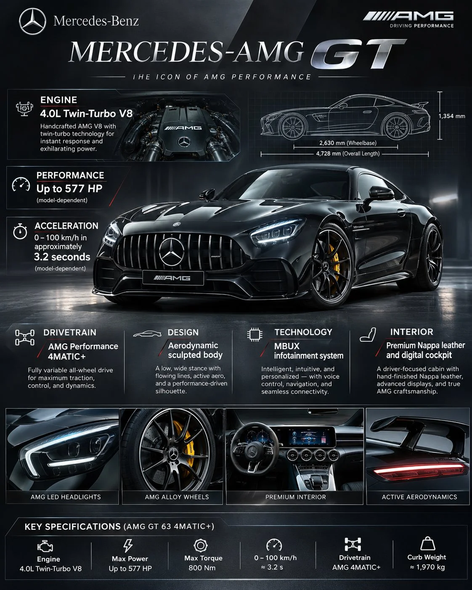

# Mercedes-AMG GT Luxury Automotive Infographic Poster

**中文标题：** 梅赛德斯-AMG GT 豪华汽车信息图海报  
**ID:** `gi25-x-1351` · **Mode:** `generate`  
**Categories:** `poster-typography`, `ecommerce`  
**Tags:** `x-twitter`, `community`, `gpt-image-2.5`, `x-direct`, `en`



### Mercedes-AMG GT Luxury Automotive Infographic Poster

```text
Create a premium, ultra-detailed automotive infographic poster featuring the Mercedes-Benz AMG GT. Use a sophisticated luxury editorial design with a cinematic black, silver, and metallic-grey color palette.

MAIN VISUAL:
Place a photorealistic Mercedes-AMG GT in the center, captured from a dramatic front three-quarter angle. Glossy metallic black paint, signature Mercedes grille, aggressive LED headlights, sculpted aerodynamic bodywork, and realistic reflections. The car should dominate the composition.

INFOGRAPHIC LAYOUT:
Surround the vehicle with elegant technical callouts, fine connecting lines, miniature specification panels, and detailed automotive annotations.

Include these sections:

ENGINE — 4.0L Twin-Turbo V8
PERFORMANCE — Up to 577 HP (model-dependent)
ACCELERATION — 0–100 km/h in approximately 3.2 seconds (model-dependent)
DRIVETRAIN — AMG Performance 4MATIC+
DESIGN — Aerodynamic sculpted body
TECHNOLOGY — MBUX infotainment system
INTERIOR — Premium Nappa leather and digital cockpit

DESIGN DETAILS:

Large elegant MERCEDES-AMG GT typography at the top.
Small Mercedes-Benz three-pointed star emblem.
Technical blueprint-style vehicle silhouette in the background.
Close-up detail insets showing the engine, alloy wheels, headlights, and interior.
Minimalist icons, precise measurements, subtle grid lines.
Sophisticated typography with clear information hierarchy.
Dark gradient background with subtle metallic textures.

ART DIRECTION:
Luxury automotive magazine meets engineering blueprint. Extremely polished Swiss editorial layout, realistic studio lighting, sharp details, premium commercial photography, restrained visual effects, perfect alignment and spacing.

OUTPUT: Vertical 4:5 poster, ultra-high resolution, photorealistic vehicle, professional infographic composition, crisp readable typography, no clutter, no spelling mistakes. Ensure all technical specifications correspond to the selected AMG GT model.
```

- **Recommended model:** `gpt-image-2.5-sunburst`
- **Settings:** _(defaults)_
- **Source:** [community](https://x.com/j_smeaton99/status/2117280746922729907) — @j_smeaton99
- **License note:** Original public X post; quoted with attribution — remix with attribution
- **Notes:** Collected directly from X; original post https://x.com/j_smeaton99/status/2117280746922729907; post text names GPT Image 2.5; discovered via X search, prompt re-verified against the original X post via api.fxtwitter.com; verified=True
- **Preview:** `previews/gi25-x-1351.webp`
