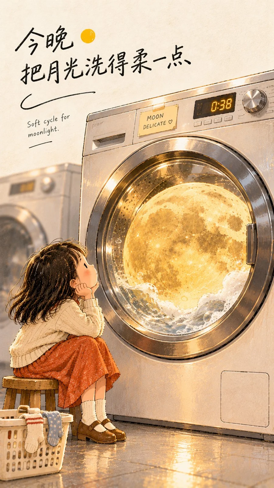

# Hand-Drawn Characters × Real Objects Creative Poster Template

**中文标题：** 手绘人物×现实物体虚实海报模板  
**ID:** `gi25-x-1352` · **Mode:** `generate`  
**Categories:** `poster-typography`, `general`  
**Tags:** `x-twitter`, `community`, `gpt-image-2.5`, `x-direct`, `zh`



### Hand-Drawn Characters × Real Objects Creative Poster Template

```text
【主题】：{填写主题}
【写实核心物体】：{月亮 / 食物 / 产品 / 花朵 / 唱片等}
【手绘人物】：{人物身份、动作与情绪}
【生活场景】：{便利店 / 房间 / 唱机 / 洗衣房 / 咖啡店等}
【主文案】：{一句简短、有画面感的中文短句}
【画幅比例】：{默认 9:16}

创作一张「手绘人物 × 现实物体」虚实结合的创意海报。

画面的核心不是单纯把照片和插画拼在一起，而是让一个高度写实的真实物体，真正进入柔软的手绘生活世界，并与手绘人物发生清楚、有趣、略带诗意的互动。

【写实核心物体】作为第一视觉焦点，保持真实材质、光影、纹理、体积和空间关系，具有明显摄影质感；周围的场景可以保留约一半真实感，例如玻璃、金属、木材、窗框、家电等结构真实可信，但边缘加入轻微彩铅、铅笔或水彩质感，使画面不会变成纯摄影。

【手绘人物】保持明显的独立绘本语言：自然铅笔轮廓、彩铅或蜡笔色块、简洁五官、轻松真实的动作，不追求真人皮肤和商业插画的精致感。人物不要刻意摆拍，而是在自然地使用、观察、等待或接触这个真实物体。

构图使用「大主体 + 大留白 + 少量生活细节」。写实核心物体要足够大，在缩略图状态下一眼就能识别；人物尺寸相对较小，通过尺度差异产生现实错位和视觉惊喜。场景只保留与主题真正有关的物件，不要为了丰富而堆满家具、装饰和道具。

背景使用温暖的奶油白、浅米色纸张质感，保留极轻的纸纤维。整体配色克制，以一个核心颜色作为视觉锚点，再搭配少量低饱和暖色或冷色。光线真实但柔和，让写实物体自然影响附近的玻璃、金属、人物和环境，而不是使用夸张 CGI 光效。

在画面留白区域加入【主文案】，使用自然、不完全规整的中文手写字体，像绘本题字、日记或手账笔迹。可加入 1 句很小的英文旁注或手写标签作为二次发现，但不要堆放大量装饰文字。

最终效果应同时具有真实摄影的质感、手绘绘本的温度和编辑海报的设计感。第一眼看到一个异常但容易理解的视觉关系，第二眼才发现人物、文字和生活细节中的小故事。

避免：纯摄影、纯插画、僵硬拼贴感、3D CGI、过度发光、复杂商业场景、大量无意义英文、满屏装饰、过度精致人物、信息过载，以及写实部分和手绘部分互不影响、像简单贴图一样的效果。
```

- **Recommended model:** `gpt-image-2.5-sunburst`
- **Settings:** _(defaults)_
- **Source:** [community](https://x.com/MrLarus/status/2117284373313839120) — @MrLarus
- **License note:** Original public X post; quoted with attribution — remix with attribution
- **Notes:** Collected directly from X; prompt posted as the author's own reply https://x.com/MrLarus/status/2117284373313839120 to https://x.com/MrLarus/status/2117283999479706099, which carries the images; GPT Image 2.5 is named in the parent post; discovered via X search, prompt re-verified against the original X post via api.fxtwitter.com; verified=True
- **Preview:** `previews/gi25-x-1352.webp`
