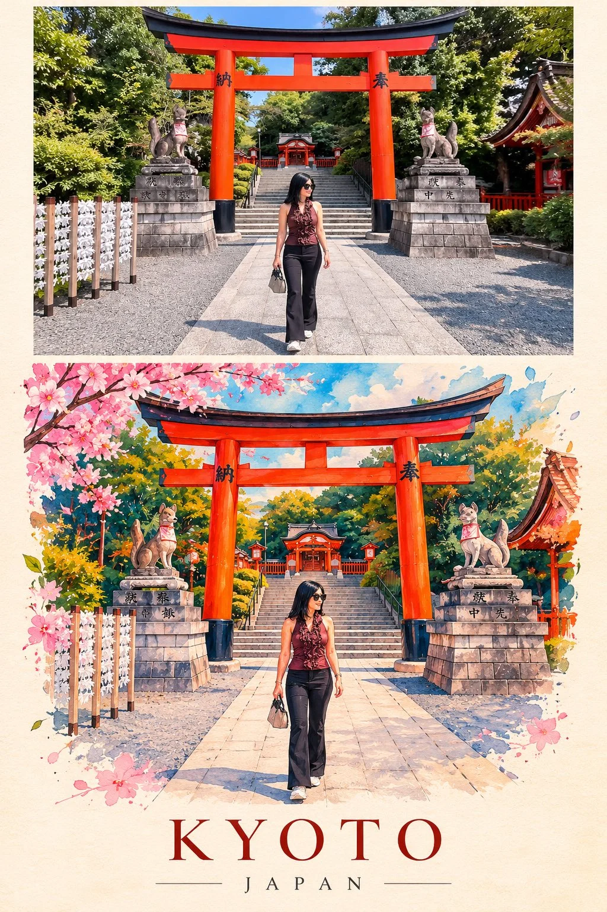

# Reality vs. Art Split-Composition Travel Artwork Template

**中文标题：** 现实×艺术上下分屏旅行艺术图模板  
**ID:** `gi25-x-1365` · **Mode:** `generate`  
**Categories:** `poster-typography`, `general`  
**Tags:** `x-twitter`, `community`, `gpt-image-2.5`, `x-direct`, `en`



### Reality vs. Art Split-Composition Travel Artwork Template

```text
Create a stunning premium vertical 2:3 split-composition artwork featuring [DESTINATION / LANDMARK / SUBJECT].

UPPER SECTION — THE REALITY

Show a breathtaking, ultra-realistic photograph of the destination. Capture its authentic architecture, environment, lighting, colours and atmosphere. Professional travel photography, natural details and cinematic composition.

LOWER SECTION — THE IMAGINATION

Recreate the exact same scene as an extraordinary contemporary mixed-media artwork.

Use a unique combination of:

Vibrant layered geometric illustrations.
Colourful cut-paper textures.
Expressive hand-painted details.
Beautiful flowing colour gradients.
Intricate artistic outlines.
Rich cobalt blue, turquoise, coral, orange, golden yellow, emerald green and violet.

Transform the surroundings into an imaginative colourful world while preserving the recognizable identity, architecture and composition of the original photograph.

Let the colours flow beyond the architectural outlines. Introduce artistic shapes, beautiful textures and subtle overlapping layers to create depth.

LAYOUT

Top 48%: realistic original photography.
Bottom 52%: imaginative colourful artwork.
Same subject and recognizable viewpoint in both sections.
Warm ivory textured background around the artwork.
Generous negative space.
Small elegant destination title at the bottom.

ART DIRECTION

Think international art exhibition meets luxury travel editorial. Unexpected colour combinations, sophisticated composition, extraordinary craftsmanship and a joyful artistic personality.

The result must look like a collectible piece of contemporary travel art, not a conventional tourist poster.

Avoid ordinary watercolor, repetitive oil-paint strokes, cartoon effects and dull colours.
```

- **Recommended model:** `gpt-image-2.5-sunburst`
- **Settings:** _(defaults)_
- **Source:** [community](https://x.com/Naiknelofar788/status/2117483542888534127) — @Naiknelofar788
- **License note:** Original public X post; quoted with attribution — remix with attribution
- **Notes:** Collected directly from X; original post https://x.com/Naiknelofar788/status/2117483542888534127; post text names GPT Image 2.5; discovered via X search, prompt re-verified against the original X post via api.fxtwitter.com; verified=True
- **Preview:** `previews/gi25-x-1365.webp`
